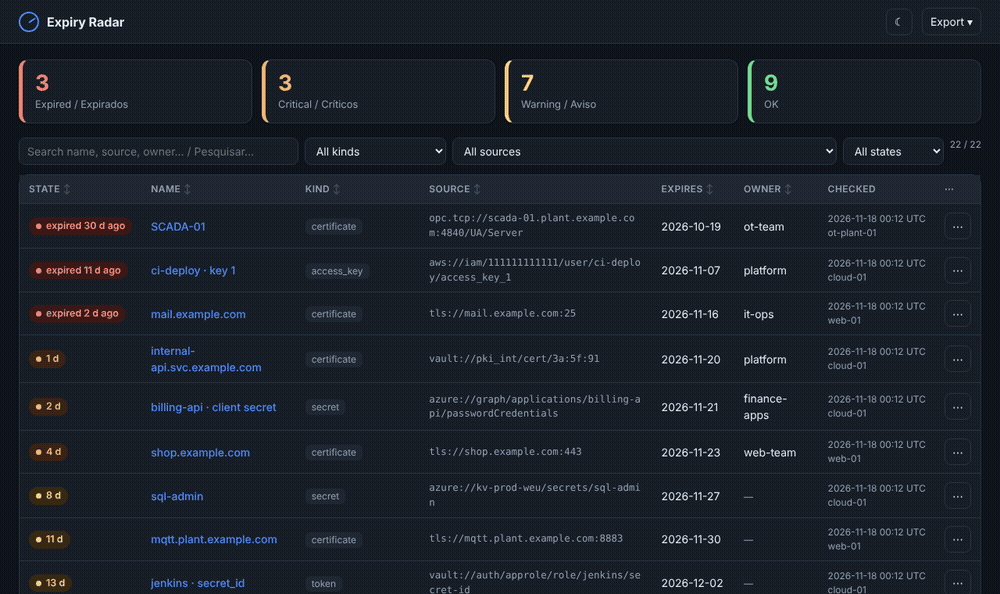
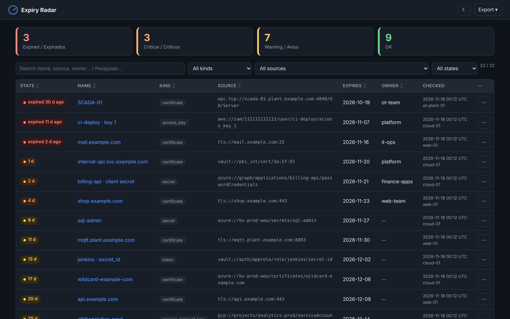
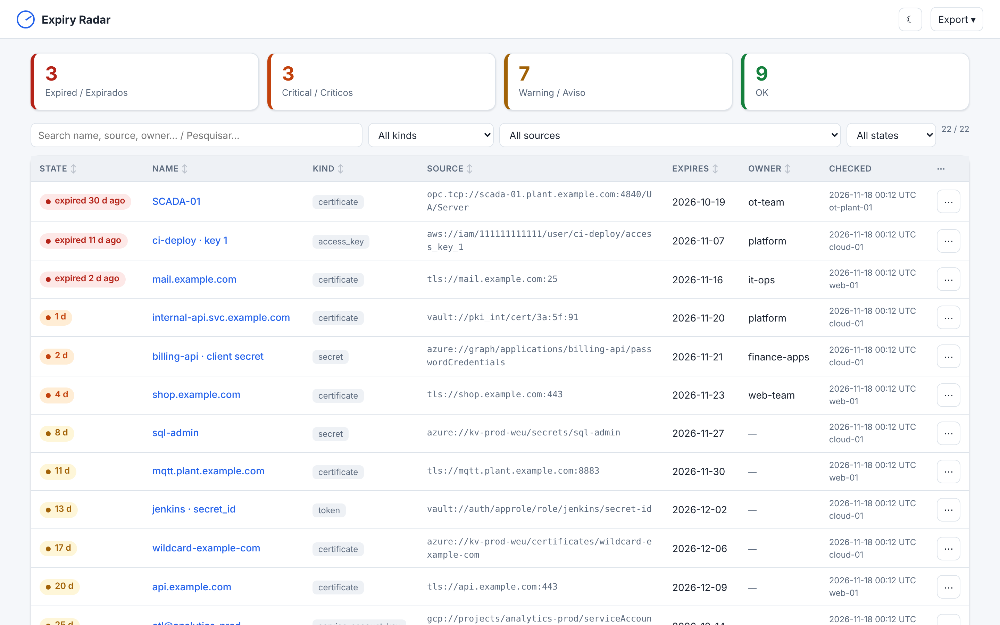
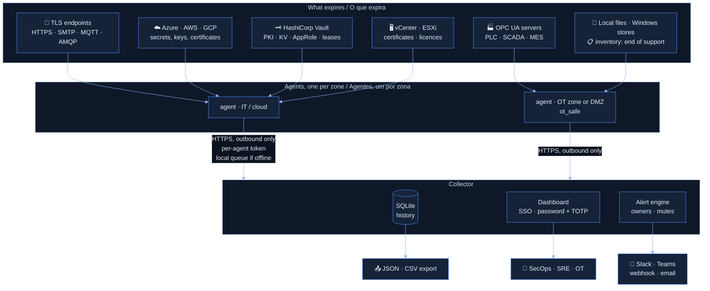

<div align="center">

# 📡 Expiry Radar

### Know what expires before it breaks production · Saiba o que expira antes de parar a produção


[](https://www.bestpractices.dev/projects/16848)

[](https://github.com/Joao-Paulino/expiry-radar/releases/latest)


**For infra and SecOps teams in hybrid environments: one dashboard for everything that expires (TLS certificates, cloud secrets and keys, Vault, VMware licences, OPC UA in OT), with no exporters and no home-made scripts. Free and open source.**

**Para equipas de infra e SecOps em ambientes híbridos: um painel para tudo o que expira (certificados TLS, segredos e chaves na cloud, Vault, licenças VMware, OPC UA em OT), sem exporters nem scripts caseiros. Gratuito e open source.**



</div>

<details>
<summary>📸 Screenshots: dark and light theme / tema escuro e claro</summary>




</details>

## ⚡ Try it in 3 minutes / Experimenta em 3 minutos

The installers download the latest release, verify its SHA-256, create the TLS certificate, the admin password with TOTP and the first agent token, and start everything as a service.
Os instaladores descarregam a última versão, verificam o SHA-256, criam o certificado TLS, a password de administração com TOTP e o token do primeiro agente, e arrancam tudo como serviço.

**Linux** (systemd):

```bash
curl -fsSLO https://raw.githubusercontent.com/Joao-Paulino/expiry-radar/main/install-expiry-radar.sh
less install-expiry-radar.sh        # read it first / lê primeiro
sudo bash install-expiry-radar.sh
```

**Windows** (PowerShell as Administrator / como Administrador):

```powershell
Invoke-WebRequest https://raw.githubusercontent.com/Joao-Paulino/expiry-radar/main/install-expiry-radar.ps1 -OutFile install-expiry-radar.ps1
notepad .\install-expiry-radar.ps1  # read it first / lê primeiro
powershell -ExecutionPolicy Bypass -File .\install-expiry-radar.ps1
```

**Docker Compose:** [`deploy/docker-compose.example.yml`](deploy/docker-compose.example.yml) (collector + agent). Then open / Depois abre `https://<host>:8443`. Every option: [examples/](examples/).

> ⭐ **Useful? Star the repo** so others in SecOps and OT find it. / **Útil? Dá uma estrela** para que outros em SecOps e OT o encontrem.
>
> 💬 **What expires in your environment that we don't cover yet?** [Tell us in Discussions](https://github.com/Joao-Paulino/expiry-radar/discussions). / **O que expira no teu ambiente e ainda não cobrimos?** Conta-nos nas Discussions.
>
> 🏭 **Running OPC UA, MQTT or SCADA?** Early feedback from OT engineers is especially welcome. / **Tens OPC UA, MQTT ou SCADA?** O feedback de quem trabalha em OT é especialmente bem-vindo.

---

## 🎯 What is this? / O que é isto?

An expired certificate is one of the most avoidable outages there is, and one of
the most common. Expiry Radar is a self-hosted, open-source tool that keeps an
inventory of what expires across your infrastructure. Small agents check
certificates where they live, a central collector stores the results, shows
them on a dashboard and alerts you on Slack, Teams, a webhook or email before
anything runs out.

Um certificado expirado é uma das falhas mais fáceis de evitar e, mesmo assim,
das mais comuns. O Expiry Radar é uma ferramenta open-source, alojada por ti,
que mantém um inventário de tudo o que expira na tua infraestrutura. Agentes
leves verificam os certificados onde eles estão, um collector central guarda os
resultados, mostra-os num painel e avisa-te por Slack, Teams, webhook ou email
antes que algo expire.

> **Milestone 1:** TLS certificates end to end. Secrets, cloud resources and
> virtualization platforms come next.
> **Milestone 1:** certificados TLS de ponta a ponta. Segredos, recursos de cloud
> e plataformas de virtualização vêm a seguir.

## ✨ Features / Funcionalidades

| | EN | PT |
|---|---|---|
| 🔐 | TLS checks, including SMTP STARTTLS | Verificação TLS, incluindo SMTP STARTTLS |
| 🚨 | Expired and untrusted certificates are reported, never skipped | Certificados expirados ou não confiáveis são reportados, nunca ignorados |
| 📦 | Single Go binary agent, no dependencies | Agente num único binário Go, sem dependências |
| 📴 | Local queue when the collector is down, sent later | Fila local quando o collector está em baixo, enviada depois |
| 📊 | Dashboard with history, mute and owner per record | Painel com histórico, silenciamento e responsável por registo |
| 📤 | JSON and CSV export | Exportação em JSON e CSV |
| 🔔 | Alerts: Slack, Microsoft Teams, webhook, encrypted email | Alertas: Slack, Microsoft Teams, webhook, email encriptado |
| 🔑 | Separate agent and admin tokens, HTTPS only | Tokens separados para agentes e administração, só HTTPS |
| 🙈 | Never stores secret values, only names and dates | Nunca guarda valores secretos, só nomes e datas |

## ⚖️ How it compares / Comparação

> **Expiry Radar is free and open source (MIT): no licence, no per-certificate pricing, no account.** /
> **O Expiry Radar é gratuito e open source (MIT): sem licença, sem preço por certificado, sem conta.**

| Tool / Ferramenta | What it covers well / O que cobre bem | What Expiry Radar adds / O que o Expiry Radar acrescenta |
|---|---|---|
| **Prometheus** (blackbox / ssl exporters) + Alertmanager | TLS certificate dates on any endpoint, alerting / Datas de certificados TLS em qualquer endpoint, alertas | Cloud secrets and keys (Key Vault, App Registrations, IAM, Secret Manager), Vault, VMware licences, OPC UA, cloud IoT (AWS IoT Core, Azure IoT Hub/DPS) and FlexLM software licences; agents only connect out (no inbound firewall rules into OT zones); inventory, history, owners and audit export out of the box / Segredos e chaves na cloud, Vault, licenças VMware, OPC UA, IoT na cloud (AWS IoT Core, Azure IoT Hub/DPS) e licenças de software FlexLM; agentes só fazem ligações de saída (sem regras de entrada nas zonas OT); inventário, histórico, donos e exportação para auditoria de origem |
| **Zabbix, Nagios, Checkmk** | General monitoring with TLS certificate checks / Monitorização geral com verificação de certificados TLS | Same as above: cloud and secret coverage without writing custom scripts / O mesmo: cobertura de cloud e segredos sem escrever scripts próprios |
| **Uptime Kuma** and similar / e semelhantes | Simple uptime and TLS expiry notifications for websites / Disponibilidade e aviso de expiração TLS para sites | Everything that is not a public website / Tudo o que não é um site público |
| **cert-manager** | Issues and renews certificates inside Kubernetes / Emite e renova certificados dentro de Kubernetes | Watches what is *outside* its reach: other clusters, VMs, appliances, cloud, OT / Vigia o que está fora do seu alcance: outros clusters, VMs, appliances, cloud, OT |
| **Cloud-native alerts** (ACM, Key Vault events, etc.) | Expiry events inside one provider / Eventos de expiração dentro de um fornecedor | One view across Azure, AWS, GCP, Vault and on-premises / Uma vista única sobre Azure, AWS, GCP, Vault e on-premises |
| **Enterprise CLM** (Keyfactor, CyberArk/Venafi, AppViewX, DigiCert, Sectigo) | Full certificate lifecycle: discovery, issuance, automated renewal, policy / Ciclo de vida completo: descoberta, emissão, renovação automática, políticas | Free and open source, a single small binary, read only, minutes to install; covers secrets, keys and licences, not only certificates. It does not issue or renew: it tells you in time / Gratuito e open source, um único binário pequeno, só leitura, instala em minutos; cobre segredos, chaves e licenças, não só certificados. Não emite nem renova: avisa a tempo |

Use Expiry Radar alongside these tools, not instead of them. / Usa o Expiry Radar em conjunto com estas ferramentas, não em vez delas.

## 🧭 How it works / Como funciona



| | EN | PT |
|---|---|---|
| 👀 **Agents** | Read only. Run next to what they check (a server, a cloud account, the OT zone). Never listen on a port; push metadata over HTTPS and queue it locally if the collector is down | Só leitura. Correm junto ao que verificam. Nunca abrem portas; enviam metadados por HTTPS e guardam em fila local se o collector estiver em baixo |
| 🧠 **Collector** | One per organization. Stores history, keeps the earliest date when agents disagree, runs the alert engine and the dashboard | Um por organização. Guarda o histórico, fica com a data mais próxima quando os agentes discordam, corre os alertas e o painel |
| 🔔 **Alerts** | 30 and 7 days before, expired, plus failing checkers and silent agents; deduplicated, with reminders | 30 e 7 dias antes, expirado, verificadores em falha e agentes silenciosos; sem duplicados, com lembretes |
| 🔒 **Trust** | Each agent has its own token bound to its ID; no secret value ever leaves the agent | Cada agente tem o seu token ligado ao ID; nenhum valor secreto sai do agente |

## 📦 Install / Instalar

**Binaries / Binários:** download from [Releases](https://github.com/Joao-Paulino/expiry-radar/releases) and check them:
descarrega de [Releases](https://github.com/Joao-Paulino/expiry-radar/releases) e verifica:

```bash
sha256sum -c SHA256SUMS --ignore-missing
gh attestation verify expiry-radar-agent-<version>-linux-amd64 --repo Joao-Paulino/expiry-radar   # build provenance
./expiry-radar-agent-<version>-linux-amd64 version
```

| Binary / Binário | Platforms / Plataformas |
|---|---|
| `expiry-radar-collector` | Linux amd64, arm64 · Windows amd64 |
| `expiry-radar-agent` | Linux amd64, arm64 · Windows amd64 |

**Docker:** multi-arch images (amd64, arm64), distroless, non-root / imagens multi-arquitetura, distroless, sem root:

```bash
docker pull ghcr.io/joao-paulino/expiry-radar-collector:latest
docker pull ghcr.io/joao-paulino/expiry-radar-agent:latest
```

Full example / Exemplo completo: [`deploy/docker-compose.example.yml`](deploy/docker-compose.example.yml).
The images have no `stty`, so `set-admin-password` shows the password while you type (it warns you).
As imagens não têm `stty`, por isso o `set-admin-password` mostra a password enquanto escreves (e avisa).

### ⚙️ Install as a service / Instalar como serviço

Collector and agent run as a service on both systems: automatic start, restart on failure, least-privileged account. Use one collector and point every agent at it (each collector has its own database).

> 💡 **Tip / Dica:** collector and agent can run on the same machine. One agent can check the certificates of all your clients: list every domain in its `tls_targets` and see them all in one dashboard.
> O collector e o agente podem correr na mesma máquina. Um só agente pode verificar os certificados de todos os teus clientes: põe todos os domínios nos `tls_targets` e vês tudo num só painel.
O collector e o agente correm como serviço nos dois sistemas: arranque automático, reinício em caso de falha, conta com o mínimo de privilégios. Usa um só collector e aponta todos os agentes para ele (cada collector tem a sua base de dados).

#### 🪟 Windows (PowerShell as Administrator / como Administrador)

```powershell
$v = (Invoke-RestMethod https://api.github.com/repos/Joao-Paulino/expiry-radar/releases/latest).tag_name   # latest release / último release
$base = "https://github.com/Joao-Paulino/expiry-radar/releases/download/$v"
New-Item -ItemType Directory C:\ExpiryRadar\collector, C:\ExpiryRadar\agent -Force | Out-Null

# Collector
cd C:\ExpiryRadar\collector
Invoke-WebRequest "$base/expiry-radar-collector-$v-windows-amd64.exe" -OutFile collector.exe
# put collector.json and the TLS certificate here / coloca aqui o collector.json e o certificado TLS
.\collector.exe install-service collector.json
icacls C:\ExpiryRadar\collector /grant "NT AUTHORITY\LocalService:(OI)(CI)M"
Start-Service ExpiryRadarCollector
New-NetFirewallRule -DisplayName "Expiry Radar 8443" -Direction Inbound -Protocol TCP -LocalPort 8443 -Action Allow

# Agent / Agente
cd C:\ExpiryRadar\agent
Invoke-WebRequest "$base/expiry-radar-agent-$v-windows-amd64.exe" -OutFile agent.exe
# put agent.json here / coloca aqui o agent.json
.\agent.exe install-service agent.json
icacls C:\ExpiryRadar\agent /grant "NT AUTHORITY\LocalService:(OI)(CI)RX"
Start-Service ExpiryRadarAgent

Get-Service ExpiryRadar*
```

| | EN | PT |
|---|---|---|
| Account | `NT AUTHORITY\LocalService` by default. `install-service <config> --account NAME` takes `LocalSystem`, `NT AUTHORITY\NetworkService` or a gMSA (`DOMAIN\name$`); accounts with a password are refused | `NT AUTHORITY\LocalService` por omissão. `install-service <config> --account NOME` aceita `LocalSystem`, `NT AUTHORITY\NetworkService` ou uma gMSA (`DOMÍNIO\nome$`); contas com password são recusadas |
| Paths | The config is checked before installing; relative paths in it are read from its folder | A config é validada antes de instalar; caminhos relativos contam a partir da sua pasta |
| Logs | Event Viewer → Windows Logs → Application, source `ExpiryRadarCollector` / `ExpiryRadarAgent` | Visualizador de Eventos → Registos do Windows → Aplicação, origem `ExpiryRadarCollector` / `ExpiryRadarAgent` |
| Restart | After 1 min on failure (3 times, counter reset daily) | Após 1 min em caso de falha (3 vezes, contador reiniciado diariamente) |
| Upgrade | `Stop-Service`, replace the `.exe` (same file name), `Start-Service` | `Stop-Service`, substituir o `.exe` (mesmo nome), `Start-Service` |
| Remove | `.\collector.exe uninstall-service` / `.\agent.exe uninstall-service` | Idem |

#### 🐧 Linux (systemd)

```bash
v=$(curl -fsSL https://api.github.com/repos/Joao-Paulino/expiry-radar/releases/latest | sed -n 's/.*"tag_name": *"\([^"]*\)".*/\1/p')   # latest release / último release
base=https://github.com/Joao-Paulino/expiry-radar/releases/download/$v
sudo useradd --system --no-create-home --shell /usr/sbin/nologin expiry-radar
sudo install -d /opt/expiry-radar /etc/expiry-radar
sudo install -d -o expiry-radar -m 700 /var/lib/expiry-radar      # db_path goes here / o db_path fica aqui

cd "$(mktemp -d)"
curl -fLO $base/expiry-radar-collector-$v-linux-amd64
curl -fLO $base/expiry-radar-agent-$v-linux-amd64
curl -fLO $base/SHA256SUMS
sha256sum -c SHA256SUMS --ignore-missing                            # both must say OK / os dois têm de dar OK
sudo install -m 755 expiry-radar-collector-$v-linux-amd64 /opt/expiry-radar/expiry-radar-collector
sudo install -m 755 expiry-radar-agent-$v-linux-amd64 /opt/expiry-radar/expiry-radar-agent

# configs: /etc/expiry-radar/collector.json and/e agent.json
sudo chown root:expiry-radar /etc/expiry-radar/*.json && sudo chmod 640 /etc/expiry-radar/*.json

for svc in collector agent; do
sudo tee /etc/systemd/system/expiry-radar-$svc.service >/dev/null <<EOF
[Unit]
Description=Expiry Radar $svc
After=network-online.target
Wants=network-online.target

[Service]
User=expiry-radar
ExecStart=/opt/expiry-radar/expiry-radar-$svc /etc/expiry-radar/$svc.json
WorkingDirectory=/var/lib/expiry-radar
Restart=on-failure
RestartSec=60
NoNewPrivileges=yes
ProtectSystem=strict
ProtectHome=yes
PrivateTmp=yes
ReadWritePaths=/var/lib/expiry-radar

[Install]
WantedBy=multi-user.target
EOF
done

sudo systemctl daemon-reload
sudo systemctl enable --now expiry-radar-collector expiry-radar-agent
systemctl status expiry-radar-collector expiry-radar-agent
journalctl -u expiry-radar-agent -f
```

Only the services you need: on an agent-only host enable just `expiry-radar-agent`. Files the agent checks must be readable by the service account (`LocalService` / `expiry-radar`). On arm64 use the `-linux-arm64` binaries.
Só os serviços de que precisas: numa máquina só com agente ativa apenas o `expiry-radar-agent`. Os ficheiros que o agente verifica têm de ser legíveis pela conta do serviço (`LocalService` / `expiry-radar`). Em arm64 usa os binários `-linux-arm64`.

> 🏗️ How it is built (components, data flow, security model): [docs/ARCHITECTURE.md](docs/ARCHITECTURE.md) / Como está construído: [docs/ARQUITETURA.md](docs/ARQUITETURA.md)

## 🚀 Quick start / Início rápido

Requires Go 1.25 or newer (releases are built with Go 1.26) · Requer Go 1.25 ou mais recente (as releases são compiladas com Go 1.26)

```bash
git clone https://github.com/Joao-Paulino/expiry-radar.git
cd expiry-radar
go test ./...
go build -o collector ./cmd/collector
./scripts/build-release.sh   # all binaries + SHA256SUMS in dist/ / todos os binários + SHA256SUMS em dist/
```

Or install directly / Ou instala diretamente:

```bash
go install github.com/Joao-Paulino/expiry-radar/cmd/collector@latest
go install github.com/Joao-Paulino/expiry-radar/cmd/agent@latest
```

### 🖥️ Collector

`collector.json`

Every option with fake values: [examples/collector.full.json](examples/collector.full.json). / Todas as opções com valores fictícios.

```json
{
  "db_path": "/var/lib/expiry-radar/radar.db",
  "listen_addr": "0.0.0.0:8443",
  "tls_cert_file": "/etc/expiry-radar/collector.crt",
  "tls_key_file": "/etc/expiry-radar/collector.key",
  "agents": [{"id": "web-01", "token": "<added by: collector add-agent collector.json web-01>"}],
  "admin_tokens": ["<admin token, see Tokens below>"],
  "alert_interval_seconds": 3600,
  "slack_webhook_url": "",
  "teams_webhook_url": "",
  "webhook_url": "",
  "email": {
    "smtp_host": "smtp.example.com",
    "smtp_port": 587,
    "security": "starttls",
    "username": "alerts@example.com",
    "password": "<smtp password>",
    "from": "alerts@example.com",
    "to": "secops@example.com"
  }
}
```

| Field / Campo | EN | PT |
|---|---|---|
| `db_path` | SQLite database file, created if missing | Ficheiro da base de dados SQLite, criado se não existir |
| `listen_addr` | Address and port the collector listens on (HTTPS only) | Endereço e porta onde o collector escuta (só HTTPS) |
| `tls_cert_file` | Collector certificate, PEM. See [🔒 Collector certificate](#-collector-certificate--certificado-do-collector) | Certificado do collector, em PEM. Ver [🔒 Certificado](#-collector-certificate--certificado-do-collector) |
| `tls_key_file` | Private key of that certificate, PEM | Chave privada desse certificado, em PEM |
| `agents` | Per-agent tokens: `[{"id": "...", "token": "..."}]`. Each token may only report as its own `agent_id`. Add one with `collector add-agent <config> <id>`. See [🔑 Tokens](#-tokens) | Tokens por agente: cada token só pode reportar como o seu `agent_id`. Cria com `collector add-agent <config> <id>`. Ver [🔑 Tokens](#-tokens) |
| `auth_tokens` | Shared agent tokens (older setups). A holder can report as **any** agent ID, so one compromised agent host could hide other agents' items. Prefer `agents`; the collector logs a warning while these are set | Tokens partilhados (instalações antigas). Quem tem um pode reportar como **qualquer** agente; prefere `agents`. O collector avisa no arranque enquanto existirem |
| `admin_tokens` | Tokens for the dashboard, mute and export. See [🔑 Tokens](#-tokens) | Tokens para o painel, silenciamento e exportação. Ver [🔑 Tokens](#-tokens) |
| `alert_interval_seconds` | How often alerts are evaluated; `0` disables alerting | De quanto em quanto tempo os alertas são avaliados; `0` desliga os alertas |
| `reminder_critical_hours` | Re-send an unchanged critical alert after this many hours (default 24, `0` = never) | Reenvia um alerta crítico inalterado ao fim destas horas (por omissão 24, `0` = nunca) |
| `reminder_warning_hours` | Same for warnings (default `0` = never) | O mesmo para avisos (por omissão `0` = nunca) |
| `checker_fail_threshold` | Consecutive failures before a checker alerts (default 3) | Falhas seguidas até um verificador alertar (por omissão 3) |
| `agent_stale_hours` | Hours without a report before an agent alerts as silent (default 3). Keep it about 2× the longest agent `interval_seconds` | Horas sem reportar até um agente alertar como silencioso (por omissão 3). Mantém cerca de 2× o maior `interval_seconds` dos agentes |
| `theme` | Dashboard colour scheme: `auto` (follow the OS, default), `dark` or `light`. Each browser can switch with the ☀/☾ button | Tema do painel: `auto` (segue o sistema, por omissão), `dark` ou `light`. Cada browser pode trocar com o botão ☀/☾ |
| `slack_webhook_url` / `teams_webhook_url` / `webhook_url` | Incoming webhook URLs; leave empty to disable | URLs de webhook; vazio desliga |
| `email` | SMTP settings. See [📧 Email](#-email). Empty `smtp_host` disables email | Definições SMTP. Ver [📧 Email](#-email). `smtp_host` vazio desliga o email |

```bash
chmod 600 collector.json      # it holds tokens and the SMTP password
./collector collector.json
```

### 🔒 Collector certificate / Certificado do collector

The collector only speaks HTTPS, so it needs a certificate (`tls_cert_file`) and
its private key (`tls_key_file`), both in PEM format. The certificate must name
the address agents use in `collector_url` in its Subject Alternative Name (SAN):
Go ignores the CN.

O collector só fala HTTPS, por isso precisa de um certificado (`tls_cert_file`)
e da respetiva chave privada (`tls_key_file`), ambos em PEM. O certificado tem
de incluir no Subject Alternative Name (SAN) o endereço que os agentes usam em
`collector_url`: o Go ignora o CN.

**Which one? / Qual escolher?**

| Your situation / A tua situação | Choose / Escolhe |
|---|---|
| Public DNS name, collector reachable from the internet / Nome DNS público, collector acessível da internet | **A. Public CA** (Let's Encrypt) |
| Company PKI (e.g. Microsoft AD CS) / PKI da empresa | **B. Internal CA** |
| Lab, home or isolated network / Laboratório, casa ou rede isolada | **C. Self-signed** |
| Fastest way to start / Forma mais rápida de começar | **C. Self-signed**, move to A or B later / e mudas para A ou B depois |

| Option / Opção | EN | PT |
|---|---|---|
| **A. Public CA** (e.g. Let's Encrypt) | Best when the collector has a public DNS name. Agents trust it with no extra setting. | O melhor quando o collector tem nome DNS público. Os agentes confiam sem configuração extra. |
| **B. Internal CA** | Use your company PKI. Give agents the CA certificate in `collector_ca_file` unless it is already in the system trust store. | Usa a PKI da empresa. Dá aos agentes o certificado da CA em `collector_ca_file`, se ainda não estiver no repositório de confiança do sistema. |
| **C. Self-signed** | Quick for labs and small setups. Copy the certificate to every agent as `collector_ca_file`. | Rápido para laboratórios e instalações pequenas. Copia o certificado para cada agente como `collector_ca_file`. |

**A. Let's Encrypt**

```bash
sudo certbot certonly --standalone -d collector.example.com
# tls_cert_file: /etc/letsencrypt/live/collector.example.com/fullchain.pem
# tls_key_file:  /etc/letsencrypt/live/collector.example.com/privkey.pem
```

The collector runs as the `expiry-radar` user, which cannot read `/etc/letsencrypt` (the key is root-only). Copy the files on every renewal with a deploy hook, then restart:
O collector corre como o utilizador `expiry-radar`, que não consegue ler `/etc/letsencrypt` (a chave só é legível pelo root). Copia os ficheiros em cada renovação com um deploy hook e reinicia:

```bash
sudo tee /etc/letsencrypt/renewal-hooks/deploy/expiry-radar.sh >/dev/null <<'HOOK'
#!/bin/sh
install -o root -g expiry-radar -m 640 "$RENEWED_LINEAGE/fullchain.pem" /etc/expiry-radar/collector.crt
install -o root -g expiry-radar -m 640 "$RENEWED_LINEAGE/privkey.pem"   /etc/expiry-radar/collector.key
systemctl restart expiry-radar-collector
HOOK
sudo chmod 755 /etc/letsencrypt/renewal-hooks/deploy/expiry-radar.sh
sudo RENEWED_LINEAGE=/etc/letsencrypt/live/collector.example.com /etc/letsencrypt/renewal-hooks/deploy/expiry-radar.sh   # first copy / primeira cópia
# tls_cert_file: /etc/expiry-radar/collector.crt   tls_key_file: /etc/expiry-radar/collector.key
```

✅ Agents trust it with no setting; certbot renews it. ⚠️ Needs a public DNS name and, with `--standalone`, port 80 reachable during validation.
✅ Os agentes confiam sem configuração; o certbot renova-o. ⚠️ Precisa de nome DNS público e, com `--standalone`, da porta 80 acessível durante a validação.

Rebuilding the collector often (labs, CI) can hit Let's Encrypt rate limits. Any ACME CA works the same way, for example ZeroSSL (free; create EAB credentials in its dashboard):
Recriar o collector muitas vezes (laboratórios, CI) pode esbarrar nos limites do Let's Encrypt. Qualquer CA ACME funciona da mesma forma, por exemplo a ZeroSSL (gratuita; cria as credenciais EAB no painel dela):

```bash
sudo certbot certonly --standalone -d collector.example.com \
  --server https://acme.zerossl.com/v2/DV90 --eab-kid <EAB_KID> --eab-hmac-key <EAB_HMAC_KEY>
```

**B. Internal CA / CA interna** (company PKI, e.g. Microsoft AD CS / PKI da empresa)

Create a key and a request, have your CA sign it, and put the issued certificate **followed by the intermediate CA** in `collector.crt`:
Cria uma chave e um pedido, pede à tua CA que o assine e põe o certificado emitido **seguido da CA intermédia** no `collector.crt`:

```bash
sudo openssl req -new -newkey ec -pkeyopt ec_paramgen_curve:P-256 -nodes \
  -keyout /etc/expiry-radar/collector.key -out collector.csr \
  -subj "/CN=collector.example.com" \
  -addext "subjectAltName=DNS:collector.example.com,IP:10.0.0.10"
# Microsoft AD CS (Windows): certreq -submit -attrib "CertificateTemplate:WebServer" collector.csr collector.cer
cat collector.cer intermediate-ca.pem | sudo tee /etc/expiry-radar/collector.crt >/dev/null
sudo chown root:expiry-radar /etc/expiry-radar/collector.key /etc/expiry-radar/collector.crt
sudo chmod 640 /etc/expiry-radar/collector.key /etc/expiry-radar/collector.crt
```

Agents trust it automatically if the root CA is in the system trust store (domain-joined Windows usually is); otherwise set `collector_ca_file` to the root CA certificate.
Os agentes confiam automaticamente se a CA raiz estiver no repositório de confiança do sistema (num Windows no domínio normalmente está); senão aponta o `collector_ca_file` para o certificado da CA raiz.

✅ Fits company security policy, no external dependency. ⚠️ Agents outside the domain need `collector_ca_file`.
✅ Integra-se na política de segurança da empresa, sem dependências externas. ⚠️ Agentes fora do domínio precisam do `collector_ca_file`.

**C. Self-signed / Autoassinado** (no OpenSSL needed: the collector generates it / sem OpenSSL: o collector gera-o)

```bash
sudo mkdir -p /etc/expiry-radar
sudo expiry-radar-collector gen-cert /etc/expiry-radar --host collector.example.com,10.0.0.10
# Windows: .\collector.exe gen-cert C:\ExpiryRadar\collector --host 192.168.1.10
```

ECDSA P-256, 365 days (`--days N`), `localhost` and `127.0.0.1` always included; it never overwrites an existing key. Replace the DNS name and IP with the ones agents will use. Then copy
`collector.crt` (never the `.key`) to each agent and point `collector_ca_file` to it.

Substitui o nome DNS e o IP pelos que os agentes vão usar. Depois copia o
`collector.crt` (nunca o `.key`) para cada agente e aponta o `collector_ca_file` para ele.

**Agents with B or C / Agentes com B ou C:** copy the CA certificate (B: the root CA, C: `collector.crt`) to **every** agent once, and point `agent.json` at it:
copia o certificado da CA (B: a CA raiz, C: o `collector.crt`) para **cada** agente uma vez e aponta o `agent.json` para ele:

```json
{
  "collector_url": "https://collector.example.com:8443",
  "collector_ca_file": "/etc/expiry-radar/collector-ca.pem"
}
```

Windows: `"collector_ca_file": "C:\\ExpiryRadar\\agent\\collector-ca.pem"`. Skip it only when the CA is already in the system trust store. With C, renewing the self-signed certificate means copying it to every agent again. / Só dispensas isto se a CA já estiver no repositório de confiança do sistema. Com C, renovar o certificado autoassinado obriga a copiá-lo de novo para cada agente.

✅ Quick, no external dependency, works on any network. ⚠️ Every agent needs `collector_ca_file`, and browsers warn when opening the dashboard.
✅ Rápido, sem dependências externas, funciona em qualquer rede. ⚠️ Cada agente precisa do `collector_ca_file` e os browsers mostram aviso ao abrir o painel.

> 🔐 The dashboard login (password + TOTP, or SSO) works the same with A, B or C, but TLS is what protects it. With a self-signed certificate, compare the fingerprint the first time (`openssl x509 -in collector.crt -noout -fingerprint -sha256`) instead of clicking through the browser warning.
> O login do painel (password + TOTP, ou SSO) funciona igual com A, B ou C, mas é o TLS que o protege. Com um certificado autoassinado, compara a impressão digital da primeira vez em vez de aceitar o aviso do browser às cegas.

> 💡 The collector loads its certificate at startup: restart it after renewing.
> Add the collector itself to an agent's `tls_targets` and Expiry Radar will warn
> you before its own certificate expires.
>
> 💡 O collector carrega o certificado no arranque: reinicia-o depois de o renovar.
> Junta o próprio collector aos `tls_targets` de um agente e o Expiry Radar avisa-te
> antes de o seu próprio certificado expirar.

### 🔔 Alerts / Alertas

| | EN | PT |
|---|---|---|
| 🆕 New or changed | Sent when something becomes a problem or its severity changes | Enviado quando algo passa a ser problema ou muda de severidade |
| ✅ Resolved | One message when it is back to OK (e.g. certificate renewed) | Uma mensagem quando volta a OK (por exemplo, certificado renovado) |
| 🔁 Reminders | Critical alerts repeat every `reminder_critical_hours`; nothing repeats every cycle | Alertas críticos repetem a cada `reminder_critical_hours`; nada se repete em cada ciclo |
| 🔇 Muted | Muted records send nothing; unmuting a still-failing record alerts again | Registos silenciados não enviam nada; ao tirar o silêncio, se ainda houver problema, volta a alertar |
| 🩺 Checker failing | A checker failing `checker_fail_threshold` times in a row on an agent | Um verificador que falha `checker_fail_threshold` vezes seguidas num agente |
| 📴 Agent silent | An agent with no report for `agent_stale_hours` | Um agente sem reportar há `agent_stale_hours` |
| 🗑️ Retired agent | **Forget** on the dashboard removes it and stops its alerts; it comes back if it reports again | **Esquecer** no painel remove-o e para os alertas; volta se reportar de novo |
| 👻 Gone items | An item missing from **two** later error-free runs of the same agent and checker (deleted, renamed, rotated away) leaves the dashboard, and its open alert gets one "no longer reported, verify it was removed on purpose" notification. Runs with errors never hide anything, and an item another agent still reports stays. `agent_id` must be unique per agent: two hosts sharing one would hide each other's items | Um item que falta em **duas** execuções posteriores sem erros do mesmo agente e checker (apagado, renomeado, rodado) sai do painel, e o alerta aberto recebe uma notificação "já não é reportado, confirma que foi removido de propósito". Execuções com erros nunca escondem nada, e um item que outro agente ainda reporta fica. O `agent_id` tem de ser único por agente: dois hosts com o mesmo esconderiam os itens um do outro |
| 📮 Delivery | An alert is only marked as sent when at least one channel delivered it; otherwise it is retried next cycle | Um alerta só fica marcado como enviado quando pelo menos um canal o entregou; senão é tentado no ciclo seguinte |

The dashboard's **Agents** section shows every agent and checker with last seen, last success and failures.
A secção **Agents** do painel mostra cada agente e verificador com a última vez visto, último sucesso e falhas.

### 🪪 SSO (Microsoft Entra ID, Google, Okta, any OIDC IdP)

Any OpenID Connect provider can be added, several at once; each gets a button on the login page. The local Administrator (password + TOTP) stays as the break-glass account.
Qualquer fornecedor OpenID Connect pode ser adicionado, vários ao mesmo tempo; cada um tem um botão na página de login. O Administrator local (password + TOTP) fica como conta de emergência.

```json
"public_url": "https://collector.example.com:8443",
"sso_session_hours": 1,
"oidc_providers": [
  { "name": "microsoft", "display_name": "Microsoft",
    "issuer": "https://login.microsoftonline.com/<tenant-id>/v2.0",
    "client_id": "<application (client) id>", "client_secret_file": "/etc/expiry-radar/entra.secret",
    "allowed_groups": ["<group object id>"], "allowed_roles": ["ExpiryRadar.Admin"] },
  { "name": "google", "display_name": "Google",
    "issuer": "https://accounts.google.com",
    "client_id": "<client id>", "client_secret_file": "/etc/expiry-radar/google.secret",
    "allowed_emails": ["joao@example.com"] }
]
```

| | EN | PT |
|---|---|---|
| ↩️ Redirect URI | Register `<public_url>/auth/<name>/callback` with the provider | Regista `<public_url>/auth/<name>/callback` no fornecedor |
| 🏢 Entra ID | App registration (single tenant), web redirect URI, client secret in a file (`chmod 600`). Authorize with **groups** (`groups` claim: token configuration → groups) or **app roles** (`roles` claim). Microsoft advises against authorizing on email | Registo de aplicação (single tenant), redirect URI web, client secret num ficheiro (`chmod 600`). Autoriza por **grupos** (claim `groups`: token configuration → groups) ou **app roles** (claim `roles`). A Microsoft desaconselha autorizar pelo email |
| 🔵 Google | OAuth client (web application). Google tokens carry no groups: use `allowed_emails` (only **verified** emails count) | Cliente OAuth (aplicação web). Os tokens Google não trazem grupos: usa `allowed_emails` (só contam emails **verificados**) |
| 🟣 Okta | OIDC web application; issuer `https://<org>.okta.com/oauth2/default`. For `allowed_groups`, add a `groups` claim to the authorization server (filter, e.g. starts with `ExpiryRadar`) | Aplicação web OIDC; para `allowed_groups`, junta um claim `groups` ao authorization server |
| 🌐 Any OIDC IdP | Keycloak (tested in CI), Auth0, Ping, JumpCloud, Authentik...: anything with OIDC discovery | Qualquer IdP com descoberta OIDC |
| 🚫 Multi-tenant | `/common`, `/organizations` and `/consumers` issuers are refused: use your tenant ID | Emissores `/common`, `/organizations` e `/consumers` são recusados: usa o ID do teu tenant |
| 👥 200+ groups | Entra omits `groups` when a user has more than 200: use app roles or assign groups to the application | O Entra omite `groups` quando o utilizador tem mais de 200: usa app roles ou atribui grupos à aplicação |
| ⏱️ Sessions | SSO sessions last at most `sso_session_hours` (default 1, max 24); removing someone from the allowed Entra group/role, or from `allowed_emails`, blocks their next login | As sessões SSO duram no máximo `sso_session_hours` (por omissão 1, máx. 24); retirar alguém do grupo/role do Entra autorizado, ou de `allowed_emails`, bloqueia o login seguinte |
| ✂️ Cut access now | **Sign out all sessions** on the dashboard ends every session immediately | **Terminar todas as sessões** no painel termina todas as sessões de imediato |
| 🔐 Protections | Authorization Code + PKCE, `state` and `nonce` (single use, 10 min), browser-bound callback, ID token signature/issuer/audience/expiry checks | Authorization Code + PKCE, `state` e `nonce` (uso único, 10 min), callback ligado ao browser, verificação de assinatura/emissor/destinatário/validade do ID token |
| 🌐 Provider down | The collector and the local login keep working; the SSO button shows an error until the provider is back | O collector e o login local continuam a funcionar; o botão SSO mostra erro até o fornecedor voltar |
| 🚦 Limits | 20 login starts per address per 10 min; at most 10 000 pending logins | 20 inícios de login por endereço a cada 10 min; no máximo 10 000 logins pendentes |

### 🔑 Tokens

Tokens are shared secrets, so generate them randomly; never invent them.
Os tokens são segredos partilhados, por isso gera-os aleatoriamente; nunca os inventes.

```bash
# Linux / macOS
openssl rand -hex 32
```

```powershell
# Windows (PowerShell 7+)
[Convert]::ToHexString([Security.Cryptography.RandomNumberGenerator]::GetBytes(32)).ToLower()
```

Each command prints a 64-character token. Run it once per token.
Cada comando gera um token de 64 caracteres. Corre-o uma vez por token.

| | EN | PT |
|---|---|---|
| `agents` | **Recommended.** `collector add-agent collector.json web-01` creates a token bound to `web-01`, saves it in the config and prints it once; put it in that agent's `token` with `"agent_id": "web-01"`, then restart the collector. A batch claiming another agent ID is refused (403) and logged. | **Recomendado.** `collector add-agent collector.json web-01` cria um token ligado a `web-01`, grava-o na config e mostra-o uma vez; põe-no no `token` desse agente, com `"agent_id": "web-01"`, e reinicia o collector. Um envio com outro `agent_id` é recusado (403) e registado. |
| `auth_tokens` | Shared tokens, kept for older setups: any agent with one can report as any agent ID. Migrate with `add-agent`, then remove them. | Tokens partilhados, mantidos para instalações antigas: qualquer agente com um pode reportar como qualquer `agent_id`. Migra com `add-agent` e depois remove-os. |
| `admin_tokens` | Tokens for the dashboard, mute and export. Must be different from every agent token. | Tokens para o painel, silenciamento e exportação. Têm de ser diferentes de todos os tokens de agente. |
| Rules | At least 32 characters; empty, short or shared tokens stop the collector from starting. | Mínimo de 32 caracteres; tokens vazios, curtos ou repetidos impedem o collector de arrancar. |
| Rotate | Add the new token, update the agents, then remove the old one. Both work in between. | Adiciona o novo token, atualiza os agentes e depois remove o antigo. Ambos funcionam entretanto. |
| Revoke | Remove the token from the list and restart the collector. | Remove o token da lista e reinicia o collector. |

Scripts use the admin token as a header; people use the login page below.
Os scripts usam o token de administração num cabeçalho; as pessoas usam a página de login abaixo.

```bash
curl -H "Authorization: Bearer <admin token>" https://<collector>:8443/export.json
```

### 🔐 Dashboard login / Login no painel

The dashboard has one **Administrator** account protected by a password **and**
an authenticator app (TOTP). Both are set on the collector server, never in a
config file. Login stays disabled until both are set.

O painel tem uma conta **Administrator** protegida por password **e** por uma
app de autenticação (TOTP). As duas são definidas no servidor do collector,
nunca num ficheiro de configuração. O login só fica ativo depois de ambas
estarem definidas.

```bash
# 1. Password (min. 12 characters, typed twice, not shown)
./collector set-admin-password collector.json

# 2. Authenticator app: scan the key, type the 6-digit code, save the 8 recovery codes
./collector set-admin-totp collector.json
#    optional QR code in the terminal / QR opcional no terminal:
#    qrencode -t ansiutf8 '<otpauth URI printed above>'
```

Then open `https://<collector>:8443/`, sign in with the password and the current
code (or a recovery code).
Depois abre `https://<collector>:8443/` e entra com a password e o código atual
(ou um código de recuperação).

| | EN | PT |
|---|---|---|
| 🔒 Lockout | 5 failed logins from one address block that address for 15 minutes; 20 failures in a row from anywhere lock the account for 15 minutes | 5 tentativas falhadas do mesmo endereço bloqueiam esse endereço durante 15 minutos; 20 falhas seguidas, de qualquer origem, bloqueiam a conta durante 15 minutos |
| 🧰 Locked out? | The admin token still works with `curl`, and `set-admin-password` clears the lock | O token de administração continua a funcionar com `curl`, e o `set-admin-password` limpa o bloqueio |
| ⏱️ Session | Ends after 30 min idle or 8 h in total; **Sign out** ends it now | Termina após 30 min sem atividade ou 8 h no total; **Sair** termina-a já |
| 🔁 Codes | Each authenticator code and each recovery code works only once | Cada código da app e cada código de recuperação só funciona uma vez |
| 🆘 Lost phone | Run `set-admin-totp` again on the server (new key, new recovery codes) | Corre de novo `set-admin-totp` no servidor (nova chave, novos códigos) |
| 🚪 Sign out everyone | Running either command signs out every open session | Correr qualquer um dos comandos termina todas as sessões abertas |
| 🔀 Reverse proxy | Login limits and logs use the client address the collector sees; behind a proxy that is the proxy's address, so expose the collector directly | Os limites de login e os logs usam o endereço que o collector vê; atrás de um proxy é o do proxy, por isso expõe o collector diretamente |
| 📝 Audit | Logins, failures, lockouts, recovery-code use (with codes left) and CSRF rejections are logged; secrets never are | Logins, falhas, bloqueios, uso de códigos de recuperação (com os que restam) e rejeições CSRF ficam no log; segredos nunca |
| 🕒 Clock | The server clock must be correct (NTP) for codes to match | O relógio do servidor tem de estar certo (NTP) para os códigos baterem certo |

### 📧 Email

Email is always encrypted; there is no plaintext mode.
O email é sempre encriptado; não existe modo sem encriptação.

| `security` | Port / Porta | EN | PT |
|---|---|---|---|
| `starttls` (default) | 587 | Upgrades to TLS and refuses to send if the server does not offer STARTTLS | Passa a TLS e recusa enviar se o servidor não suportar STARTTLS |
| `tls` | 465 | TLS from the first byte | TLS desde o primeiro byte |

`username` and `password` are optional (SMTP AUTH), and are only sent after the
connection is encrypted. The server certificate is verified, TLS 1.2 minimum.
`username` e `password` são opcionais (SMTP AUTH) e só são enviados depois de a
ligação estar encriptada. O certificado do servidor é verificado, com TLS 1.2 no mínimo.

### 🛰️ Agent / Agente

`agent.json`

Every option with fake values: [examples/agent.full.json](examples/agent.full.json); ready-made per scenario (Azure, AWS, GCP, Vault, VMware, Windows/IIS, OT/ICS, IIoT/IoT): [examples/](examples/). / Todas as opções com valores fictícios; exemplos prontos por cenário em [examples/](examples/).

```json
{
  "collector_url": "https://collector.example.com:8443",
  "collector_ca_file": "/etc/expiry-radar/collector-ca.pem",
  "token": "<this agent's token from: collector add-agent collector.json web-01>",
  "agent_id": "web-01",
  "queue_path": "/var/lib/expiry-radar/queue.jsonl",
  "interval_seconds": 3600,
  "tls_targets": [
    { "host": "www.example.com", "port": 443 },
    { "host": "mail.example.com", "port": 25, "start_tls": "smtp" }
  ]
}
```

```bash
chmod 600 agent.json          # it holds the agent token
./agent agent.json
```

| Field / Campo | EN | PT |
|---|---|---|
| `collector_url` | Collector address, e.g. `https://collector:8443` (`/ingest` is added automatically); must use `https://` | Endereço do collector, por exemplo `https://collector:8443` (o `/ingest` é acrescentado automaticamente); tem de usar `https://` |
| `collector_ca_file` | Collector CA certificate, PEM; only for internal CA or self-signed (options B and C above) | Certificado da CA do collector, em PEM; só para CA interna ou autoassinado (opções B e C acima) |
| `token` | This agent's token (`collector add-agent`); its `agent_id` must match | O token deste agente (`collector add-agent`); o `agent_id` tem de coincidir |
| `agent_id` | Name of this agent, shown on the dashboard | Nome deste agente, mostrado no painel |
| `queue_path` | Local file where results wait while the collector is unreachable | Ficheiro local onde os resultados esperam enquanto o collector não responde |
| `interval_seconds` | Seconds between checks; the first check runs at startup | Segundos entre verificações; a primeira corre no arranque |
| `tls_targets` | Hosts to check: `host`, `port`, and `start_tls: "smtp"` for mail servers | Servidores a verificar: `host`, `port`, e `start_tls: "smtp"` para servidores de email |

### 🔒 HashiCorp Vault (PKI, KV v2, tokens, AppRole, leases)

The agent can also check a Vault: certificates issued by PKI mounts and the mounts' CAs, KV v2 secrets with an expiry date in their metadata (e.g. a third-party API key), AppRole secret IDs and, optionally, tokens and dynamic secret leases (databases, cloud credentials). It only reads certificate data, metadata and accessor lookups, never secret values, tokens or secret IDs.
O agente também pode verificar um Vault: certificados emitidos pelos mounts PKI e as respetivas CAs, segredos KV v2 com data de validade nos metadados (ex.: uma API key de terceiros), secret IDs de AppRole e, opcionalmente, tokens e leases de segredos dinâmicos (bases de dados, credenciais cloud). Só lê dados de certificados, metadados e consultas por accessor, nunca valores de segredos, tokens ou secret IDs.

Add to `agent.json` / Acrescenta ao `agent.json`:

```json
"vault": {
  "address": "https://vault.example.com:8200",
  "ca_file": "/etc/expiry-radar/vault-ca.pem",
  "namespace": "",
  "auth": { "approle": { "role_id": "<role id>", "secret_id_file": "/etc/expiry-radar/vault-secret-id" } },
  "pki_mounts": ["pki", "pki_int"],
  "kv_mounts": ["secret"],
  "kv_expiry_key": "expires_at",
  "approle_mounts": ["approle"],
  "check_tokens": false,
  "token_min_ttl_hours": 24,
  "lease_prefixes": [],
  "lease_min_ttl_hours": 24
}
```

Set at least one of `pki_mounts` / `kv_mounts` / `approle_mounts` / `check_tokens` / `lease_prefixes` · Define pelo menos um destes. `kv_expiry_key` is optional (default `expires_at`) · é opcional (por omissão `expires_at`).

Mark a KV secret with its expiry date / Marca um segredo KV com a data de validade (`2027-03-31` or RFC 3339 `2027-03-31T00:00:00Z`):

```bash
vault kv metadata put -custom-metadata=expires_at=2027-03-31 secret/apps/stripe/api-key
```

Least-privilege policy and AppRole / Policy de privilégio mínimo e AppRole (repeat the paths for each mount / repete os caminhos para cada mount). KV: metadata only, no access to `secret/data/*` · KV: só metadados, sem acesso a `secret/data/*`:

```bash
vault policy write expiry-radar - <<'HCL'
path "pki/certs"    { capabilities = ["list"] }
path "pki/cert/*"   { capabilities = ["read"] }
path "pki/issuers"  { capabilities = ["list"] }
path "pki/issuer/*" { capabilities = ["read"] }
path "secret/metadata/*" { capabilities = ["list", "read"] }
path "auth/approle/role"                             { capabilities = ["list"] }
path "auth/approle/role/+/secret-id"                 { capabilities = ["list"] }
path "auth/approle/role/+/secret-id-accessor/lookup" { capabilities = ["update"] }
HCL
vault auth enable approle
vault write auth/approle/role/expiry-radar token_policies=expiry-radar token_ttl=5m
vault read -field=role_id auth/approle/role/expiry-radar/role-id
vault write -f -field=secret_id auth/approle/role/expiry-radar/secret-id > vault-secret-id && chmod 600 vault-secret-id
```

| | EN | PT |
|---|---|---|
| 🔑 Auth | AppRole (logs in every run and revokes the token afterwards) or `"token_file"` | AppRole (faz login a cada verificação e revoga o token no fim) ou `"token_file"` |
| 🔁 Renewed certificates | Vault keeps old certificates listed until `tidy`; only the latest per name is reported | O Vault mantém certificados antigos até ao `tidy`; só o mais recente por nome é reportado |
| 🚫 Skipped | Revoked certificates and ones expired more than 30 days ago | Certificados revogados e expirados há mais de 30 dias |
| 🎫 Tokens (`check_tokens`) | Off by default. Listing token accessors is root-protected in Vault and needs `sudo` (add the two paths below). With it, a compromised agent could map every token and its policies (not read or revoke them). Skips tokens without expiry, the agent's own and those created with a TTL below `token_min_ttl_hours` | Desligado por omissão. Listar accessors de tokens é protegido no Vault e exige `sudo` (acrescenta os dois caminhos abaixo). Com isso, um agente comprometido conseguiria mapear todos os tokens e as políticas (não lê-los nem revogá-los). Ignora tokens sem expiração, o do próprio agente e os criados com TTL abaixo de `token_min_ttl_hours` |
| ⏳ Leases (`lease_prefixes`) | Off by default. Lease ID prefixes such as `database/creds/`; listing leases needs `sudo`, scoped to those prefixes only (policy below). Skips leases granted for less than `lease_min_ttl_hours` (short credentials meant to be re-issued). Vault does not expose a lease's max TTL: the current expiry is reported | Desligado por omissão. Prefixos de lease como `database/creds/`; listar leases exige `sudo`, limitado a esses prefixos (policy abaixo). Ignora leases concedidos por menos de `lease_min_ttl_hours` (credenciais curtas para reemitir). O Vault não expõe o max TTL de um lease: é reportada a expiração atual |
| 🔐 AppRole secret IDs | Secret IDs with a TTL; names show only the first 8 characters of the accessor | Secret IDs com TTL; os nomes mostram só os 8 primeiros caracteres do accessor |
| 🗝️ KV secrets | Only secrets with the expiry key; deleted current versions and invalid dates are skipped (invalid dates are logged). KV v2 only | Só segredos com a chave de validade; versões atuais apagadas e datas inválidas são ignoradas (as inválidas ficam no log). Só KV v2 |
| 🏢 Enterprise | Set `namespace` for Vault Enterprise / HCP namespaces | Define `namespace` para namespaces do Vault Enterprise / HCP |

Policy for `check_tokens` / Policy para `check_tokens` (⚠️ `sudo`):

```hcl
path "auth/token/accessors"       { capabilities = ["list", "sudo"] }
path "auth/token/lookup-accessor" { capabilities = ["update"] }
```

Policy for `lease_prefixes` / Policy para `lease_prefixes` (⚠️ `sudo`, one line per prefix / uma linha por prefixo):

```hcl
path "sys/leases/lookup/database/creds/*" { capabilities = ["list", "sudo"] }
path "sys/leases/lookup"                  { capabilities = ["update"] }
```

### 🔷 Azure (Key Vault, App Registrations, Enterprise Apps, managed certificates, IoT Hub/DPS)

The agent can also check Azure Key Vaults (certificates, secrets and keys with an expiry date) and, via Microsoft Graph, the client secrets and certificates of App Registrations and the SAML signing certificates of Enterprise Apps. It only calls list endpoints, which return attributes, never values. No Azure SDK: plain REST, so no extra dependencies.
O agente também pode verificar Azure Key Vaults (certificados, segredos e chaves com data de validade) e, via Microsoft Graph, os client secrets e certificados das App Registrations e os certificados de assinatura SAML das Enterprise Apps. Só chama endpoints de listagem, que devolvem atributos, nunca valores. Sem SDK do Azure: REST direto, sem dependências extra.

```json
"azure": {
  "tenant_id": "<tenant id>",
  "client_id": "<client id>",
  "auth": "managed_identity",
  "certificate_file": "/etc/expiry-radar/azure-sp.pem",
  "token_file": "",
  "key_vaults": ["kv-prod-weu", "kv-shared"],
  "subscriptions": ["<subscription id>"],
  "discover_key_vaults": false,
  "app_registrations": true,
  "service_principals": true,
  "managed_certificates": true,
  "iot_certificates": true
}
```

| | EN | PT |
|---|---|---|
| 🔑 `managed_identity` | VM, VMSS, AKS node, App Service, Container Apps or Azure Arc server; detected from the environment. `client_id` only for a user-assigned identity | VM, VMSS, nó AKS, App Service, Container Apps ou servidor Azure Arc; detetado pelo ambiente. `client_id` só para identidade user-assigned |
| 📜 `certificate` | Service principal with a certificate: `certificate_file` = PEM with the certificate (a chain is fine; the one matching the key is used) and its unencrypted RSA key (`chmod 600`). The key never leaves the agent | Service principal com certificado: `certificate_file` = PEM com o certificado (pode ter a cadeia; é usado o que corresponde à chave) e a chave RSA sem password (`chmod 600`). A chave nunca sai do agente |
| 🔗 `workload_identity` | Federated token (AKS workload identity, GitHub Actions, other clouds). `token_file`, `tenant_id`, `client_id` default to `AZURE_FEDERATED_TOKEN_FILE`, `AZURE_TENANT_ID`, `AZURE_CLIENT_ID` | Token federado (workload identity do AKS, GitHub Actions, outras clouds). `token_file`, `tenant_id`, `client_id` usam por omissão `AZURE_FEDERATED_TOKEN_FILE`, `AZURE_TENANT_ID`, `AZURE_CLIENT_ID` |
| 🖥️ Azure Arc | The agent's user must be in the `himds` group (Linux) or Administrators / *Hybrid agent extension applications* (Windows), and `IDENTITY_ENDPOINT` + `IMDS_ENDPOINT` must be in the service environment (e.g. systemd `Environment=`); without them the agent uses 169.254.169.254, which outside Azure is another cloud's metadata service | O utilizador do agente tem de estar no grupo `himds` (Linux) ou Administrators / *Hybrid agent extension applications* (Windows), e `IDENTITY_ENDPOINT` + `IMDS_ENDPOINT` têm de estar no ambiente do serviço (ex.: `Environment=` do systemd); sem elas o agente usa 169.254.169.254, que fora do Azure é o serviço de metadados de outra cloud |
| 🗂️ Vaults | `key_vaults` (least privilege) and/or `discover_key_vaults: true` (every vault in `subscriptions`, any region; adds `location`, `resource_group`, `subscription` to the records; each vault then needs Key Vault Reader, or list on access-policy vaults, otherwise every run reports an error) | `key_vaults` (privilégio mínimo) e/ou `discover_key_vaults: true` (todos os vaults das `subscriptions`, qualquer região; acrescenta `location`, `resource_group`, `subscription` aos registos; cada vault precisa então de Key Vault Reader, ou list nos vaults com access policies, senão cada execução reporta erro) |
| 🪪 `app_registrations` / `service_principals` | Client secrets (kind `secret`) and certificates (kind `certificate`) of every App Registration; SAML signing and other certificates of Enterprise Apps (listed once, not per usage; the PFX password Azure adds is not a separate secret). Managed identities and Microsoft's own service principals are skipped. Names end with the first 8 characters of the key id, so a rotation pair with the same description stays two items. Public cloud only. Needs Graph `Application.Read.All` (application permission, admin consent; reads metadata of every app, nothing narrower exists). Secret values are never returned by Graph and the hint is not stored. Credentials expired more than 30 days ago are skipped | Client secrets (kind `secret`) e certificados (kind `certificate`) de todas as App Registrations; certificados SAML e outros das Enterprise Apps (uma vez, não por utilização; a password do PFX que o Azure acrescenta não conta como secret). Managed identities e service principals da própria Microsoft são ignorados. Os nomes terminam com os 8 primeiros caracteres do key id, para que um par em rotação com a mesma descrição continue a ser dois itens. Só cloud pública. Exige `Application.Read.All` no Graph (permissão de aplicação, admin consent; lê metadados de todas as apps, não existe nada mais restrito). O Graph nunca devolve valores de secrets e o hint não é guardado. Credenciais expiradas há mais de 30 dias são ignoradas |
| 📜 `managed_certificates` | Needs `subscriptions` (Reader). App Service certificates (managed, imported, Key Vault-linked), App Service Certificate orders (`auto_renew` in metadata), Front Door Standard/Premium certificates (managed and customer) and Application Gateway listener certificates (read from the public certificate). A certificate in a Key Vault **and** on an Application Gateway shows twice on purpose: a gateway pinned to an old secret version keeps serving the old certificate after the vault is renewed. Expired certificates keep alerting (they may still be served). Providers never registered in a subscription are skipped. A purchased App Service Certificate imported into an app shows as the order and as the app certificate. Front Door classic / CDN classic are not checked | Exige `subscriptions` (Reader). Certificados do App Service (managed, importados, ligados ao Key Vault), App Service Certificates comprados (`auto_renew` nos metadados), certificados do Front Door Standard/Premium (managed e do cliente) e certificados dos listeners do Application Gateway (lidos do certificado público). Um certificado num Key Vault **e** num Application Gateway aparece duas vezes de propósito: um gateway preso a uma versão antiga do segredo continua a servir o certificado antigo depois de o vault ser renovado. Certificados expirados continuam a alertar (podem ainda estar em uso). Providers nunca registados numa subscrição são ignorados. Um App Service Certificate comprado e importado numa app aparece como encomenda e como certificado da app. Front Door clássico / CDN clássico não são verificados |
| 📡 `iot_certificates` | Needs `subscriptions` (Reader). CA certificates uploaded to every IoT Hub and Device Provisioning Service (DPS) in the subscription — the certificates used to authenticate devices by X.509 CA, not individual device identities. ARM returns the expiry directly (`properties.expiry`), no PEM parsing | Exige `subscriptions` (Reader). Certificados de CA carregados em cada IoT Hub e Device Provisioning Service (DPS) da subscrição — os certificados usados para autenticar dispositivos por CA X.509, não identidades individuais. O ARM devolve a validade diretamente (`properties.expiry`), sem analisar o PEM |
| 🚫 Skipped | Items without an expiry date, disabled items, and the secret and key Key Vault creates behind each certificate | Itens sem data de validade, itens desativados e o segredo e a chave que o Key Vault cria por trás de cada certificado |
| 🌐 Networks | One agent covers every region. A vault with private endpoint / firewall must be reachable (VNet + `privatelink.vaultcore.azure.net` DNS, or an allowed IP); otherwise that vault reports `403 ForbiddenByFirewall` or a DNS error and the others still count. Isolated networks: one agent per VNet/hub | Um agente cobre todas as regiões. Um vault com private endpoint / firewall tem de estar acessível (VNet + DNS `privatelink.vaultcore.azure.net`, ou IP permitido); senão esse vault dá `403 ForbiddenByFirewall` ou erro de DNS e os outros continuam. Redes isoladas: um agente por VNet/hub |

Permissions / Permissões (`<principal>` = the identity's object id / object id da identidade):

```bash
# RBAC vaults: Key Vault Reader (metadata only, no values) on each vault
az role assignment create --assignee-object-id <principal> --assignee-principal-type ServicePrincipal --role "Key Vault Reader" \
  --scope "$(az keyvault show -n kv-prod-weu --query id -o tsv)"
# Vaults with access policies: list only (list never returns values)
az keyvault set-policy -n kv-prod-weu --object-id <principal> \
  --certificate-permissions list --secret-permissions list --key-permissions list
# discover_key_vaults / managed_certificates: Reader on the subscription
az role assignment create --assignee-object-id <principal> --assignee-principal-type ServicePrincipal --role Reader --scope /subscriptions/<subscription id>
```

Graph permission / Permissão no Graph (`app_registrations`, `service_principals`):

```bash
GRAPH=00000003-0000-0000-c000-000000000000; ROLE=9a5d68dd-52b0-4cc2-bd40-abcf44ac3a30   # Application.Read.All
# service principal (certificate / workload identity)
az ad app permission add --id <app id> --api $GRAPH --api-permissions $ROLE=Role
az ad app permission admin-consent --id <app id>
# managed identity (no portal button): assign the Graph app role
az rest --method POST --uri "https://graph.microsoft.com/v1.0/servicePrincipals/<identity object id>/appRoleAssignments" \
  --body "{\"principalId\":\"<identity object id>\",\"resourceId\":\"$(az ad sp show --id $GRAPH --query id -o tsv)\",\"appRoleId\":\"$ROLE\"}"
```

Set-up per auth / Configuração por autenticação:

```bash
# certificate: creates the app + service principal and a PEM with cert and key
az ad sp create-for-rbac --name expiry-radar --create-cert   # "fileWithCertAndPrivateKey" -> certificate_file
# workload_identity on AKS: federate a user-assigned identity with the agent's service account
az identity federated-credential create --name expiry-radar --identity-name expiry-radar -g <rg> \
  --issuer "$(az aks show -n <aks> -g <rg> --query oidcIssuerProfile.issuerUrl -o tsv)" \
  --subject system:serviceaccount:<namespace>:expiry-radar
```

<details><summary>CI against a real Key Vault (optional) / CI contra um Key Vault real (opcional)</summary>

GitHub Actions is the workload identity, no secret stored. The `azure` CI job runs only when these repository variables exist. One command does it all: `scripts/azure-ci-setup.sh <resource-group> <location> <vault-name>` (e.g. in Azure Cloud Shell); the steps it runs:
O GitHub Actions é a workload identity, sem segredos guardados. O job `azure` do CI só corre quando estas variáveis existem no repositório. Um só comando faz tudo: `scripts/azure-ci-setup.sh <resource-group> <location> <nome-do-vault>` (ex.: no Azure Cloud Shell); os passos que executa:

```bash
APP=$(az ad app create --display-name expiry-radar-ci --query appId -o tsv)
az ad sp create --id "$APP"
for s in ref:refs/heads/main pull_request; do
  az ad app federated-credential create --id "$APP" --parameters "{\"name\":\"gh-${s//[:\/]/-}\",\"issuer\":\"https://token.actions.githubusercontent.com\",\"subject\":\"repo:Joao-Paulino/expiry-radar:$s\",\"audiences\":[\"api://AzureADTokenExchange\"]}"
done
az keyvault create -n <test vault> -g <rg> -l westeurope --enable-rbac-authorization true
az role assignment create --assignee "$APP" --role "Key Vault Reader" --scope "$(az keyvault show -n <test vault> --query id -o tsv)"
# test items (you need Key Vault Administrator on the vault for this)
az keyvault certificate create --vault-name <test vault> -n er-test-cert -p "$(az keyvault certificate get-default-policy)"
az keyvault secret set --vault-name <test vault> -n er-test-secret --value dummy --expires 2027-12-31T00:00:00Z
az keyvault key create --vault-name <test vault> -n er-test-key --expires 2027-12-31T00:00:00Z
gh variable set AZURE_TEST_TENANT_ID -b "$(az account show --query tenantId -o tsv)"
gh variable set AZURE_TEST_CLIENT_ID -b "$APP"
gh variable set AZURE_TEST_VAULT -b <test vault>
# optional: also test App Registrations (grant Application.Read.All to the CI app as above)
gh variable set AZURE_TEST_GRAPH -b 1
```
</details>

### 🟧 AWS (ACM, IAM server certificates, access keys, Secrets Manager, IoT Core)

The agent can also check AWS: ACM certificates (issued, **imported** and **ACME** — the last two never renew on their own) and IAM server certificates, in several regions and accounts. Requests are signed with SigV4 by the agent itself (no AWS SDK). Static access keys are not supported, on purpose.
O agente também pode verificar a AWS: certificados do ACM (emitidos, **importados** e **ACME** — os dois últimos nunca renovam sozinhos) e IAM server certificates, em várias regiões e contas. Os pedidos são assinados com SigV4 pelo próprio agente (sem SDK da AWS). Access keys estáticas não são suportadas, de propósito.

```json
"aws": {
  "auth": "instance_role",
  "regions": ["eu-west-1", "us-east-1"],
  "assume_roles": [{ "role_arn": "arn:aws:iam::222222222222:role/expiry-radar-read", "external_id": "optional" }],
  "services": ["acm", "iam_server_certificates", "access_keys", "secrets_manager", "iot_core"],
  "access_key_max_age_days": 90,
  "secret_max_age_days": 0
}
```

| | EN | PT |
|---|---|---|
| 🖥️ `instance_role` | EC2 (IMDSv2 only), ECS / Fargate task role, EKS Pod Identity; detected from the environment | EC2 (só IMDSv2), task role ECS / Fargate, EKS Pod Identity; detetado pelo ambiente |
| 🔗 `web_identity` | EKS IRSA or any platform that keeps a fresh OIDC token in a file: `token_file` + `role_arn` (default `AWS_WEB_IDENTITY_TOKEN_FILE`, `AWS_ROLE_ARN`). The file is re-read on every refresh | EKS IRSA ou qualquer plataforma que mantenha um token OIDC atualizado num ficheiro: `token_file` + `role_arn` (por omissão `AWS_WEB_IDENTITY_TOKEN_FILE`, `AWS_ROLE_ARN`). O ficheiro é relido em cada renovação |
| 📜 `roles_anywhere` | On-premises servers: IAM Roles Anywhere with an X.509 certificate (`certificate_file` PEM with certificate, optional chain and RSA/ECDSA key; `trust_anchor_arn`, `profile_arn` in the same region, which is used; `role_arn`) | Servidores on-prem: IAM Roles Anywhere com certificado X.509 (`certificate_file` PEM com certificado, cadeia opcional e chave RSA/ECDSA; `trust_anchor_arn`, `profile_arn` na mesma região, que é a usada; `role_arn`) |
| 🏢 Multi-account | `assume_roles`: a read-only role in each account (`sts:AssumeRole`, optional `external_id`); `skip_base_account: true` to check only those | `assume_roles`: uma role só de leitura em cada conta (`sts:AssumeRole`, `external_id` opcional); `skip_base_account: true` para verificar só essas |
| 🌍 Regions | `regions` for ACM and Secrets Manager (only regions enabled in every account: a disabled one is reported as an error); IAM is global. `region` (STS) defaults to the first one. Standard `aws` partition only (not China / GovCloud / ISO yet). The host clock must be right (SigV4 allows 5 minutes) | `regions` para o ACM e o Secrets Manager (só regiões ativas em todas as contas: uma desativada aparece como erro); o IAM é global. `region` (STS) é por omissão a primeira. Só a partição `aws` standard (ainda não China / GovCloud / ISO). O relógio do servidor tem de estar certo (o SigV4 tolera 5 minutos) |
| 🔑 `access_keys` | From the IAM credential report (one per account, up to 4 hours old; the keys are never seen), as a separate checker `aws-access-keys`. Access keys never expire: an active key is due `access_key_max_age_days` (default 90, CIS) after its last rotation; a rotated key is a new item. Any root key is due at once (root should have none). **Inactive** keys are shown as `inactive (no alerts)` on the dashboard and in exports and never alert: they cannot be used, but should be deleted | Do credential report do IAM (um por conta, até 4 horas de idade; as chaves nunca são vistas), como checker separado `aws-access-keys`. As access keys não expiram: uma chave ativa vence `access_key_max_age_days` (por omissão 90, CIS) depois da última rotação; uma chave rodada é um item novo. Qualquer chave root vence logo (a root não devia ter nenhuma). Chaves **inativas** aparecem como `inactive (no alerts)` no painel e nos exports e nunca alertam: não podem ser usadas, mas devem ser apagadas |
| 🗝️ `secrets_manager` | Separate checker `aws-secrets`; metadata only (never `GetSecretValue`). Rotation on: due at the next scheduled rotation **or** at the last successful rotation + interval + 2 days, whichever is first (a failing scheduled rotation may move the next date forward); rotation on without a date is due now. Rotation off: due `secret_max_age_days` after the **current value** was created (tag or description edits do not reset it), not reported when 0 (default) nor for service-owned secrets. A replica is reported once, from its primary region. Secrets scheduled for deletion are not listed | Checker separado `aws-secrets`; só metadados (nunca `GetSecretValue`). Rotação ligada: vence na próxima rotação agendada **ou** na última rotação bem-sucedida + intervalo + 2 dias, o que vier primeiro (uma rotação agendada que falha pode adiar a próxima data); rotação ligada sem data vence logo. Rotação desligada: vence `secret_max_age_days` depois de o **valor atual** ter sido criado (editar tags ou descrição não reinicia), não é reportado com 0 (por omissão) nem para segredos de serviços AWS. Uma réplica é reportada uma vez, a partir da região primária. Segredos agendados para apagar não são listados |
| 📡 `iot_core` | Regional, like ACM and Secrets Manager (needs `regions`). Device certificates: `ListCertificates` paged, then `DescribeCertificate` per certificate for the expiry (`validity.notAfter`); revoked certificates are skipped before that second call. Registered CA certificates: `ListCACertificates` paged the same way, then `DescribeCACertificate`; inactive CAs are skipped | Regional, como o ACM e o Secrets Manager (exige `regions`). Certificados de dispositivo: `ListCertificates` paginado, depois `DescribeCertificate` por certificado para a validade (`validity.notAfter`); os revogados são ignorados antes dessa segunda chamada. CAs registadas: `ListCACertificates` paginado da mesma forma, depois `DescribeCACertificate`; as CAs inativas são ignoradas |
| 🚫 Skipped | ACM certificates pending validation (no date yet), revoked, failed, timed out or inactive. Expired ones keep alerting (they may still be served) | Certificados ACM à espera de validação (ainda sem data), revogados, falhados, expirados por timeout ou inativos. Os expirados continuam a alertar (podem ainda estar em uso) |

Read-only policy / Policy só de leitura (in each account / em cada conta):

```json
{ "Version": "2012-10-17", "Statement": [{ "Effect": "Allow",
  "Action": ["acm:ListCertificates", "iam:ListServerCertificates",
             "iam:GenerateCredentialReport", "iam:GetCredentialReport",
             "secretsmanager:ListSecrets", "secretsmanager:ListSecretVersionIds",
             "iot:ListCertificates", "iot:DescribeCertificate",
             "iot:ListCACertificates", "iot:DescribeCACertificate"], "Resource": "*" }] }
```

Multi-account / Multi-conta: the base role also needs `sts:AssumeRole` on the `assume_roles` ARNs; each target role trusts the base role (`"Principal": {"AWS": "<base role ARN>"}`, with an `sts:ExternalId` condition if you set `external_id`) / a role base precisa também de `sts:AssumeRole` sobre os ARNs de `assume_roles`; cada role de destino confia na role base (com a condição `sts:ExternalId` se definires `external_id`).

Trust for the agent's own role / Confiança da role do próprio agente: IRSA → the cluster's OIDC provider with an `aud`/`sub` condition; Roles Anywhere → `"Service": "rolesanywhere.amazonaws.com"` with `sts:AssumeRole`, `sts:TagSession`, `sts:SetSourceIdentity`. `sts:GetCallerIdentity` needs no permission.

### 🟦 Google Cloud (certificates, service account keys, Secret Manager)

Certificate Manager and Compute (load balancer) SSL certificates, user-managed service account keys and Secret Manager expiry / rotation. Plain REST (no Google SDK), read-only, never a secret value. Service account key files are not supported for the agent itself, on purpose.
Certificados do Certificate Manager e SSL do Compute (load balancers), chaves de service accounts geridas pelo utilizador e expiração / rotação do Secret Manager. REST direto (sem SDK da Google), só leitura, nunca um valor de segredo. Ficheiros de chave de service account não são suportados para o próprio agente, de propósito.

```json
"gcp": {
  "auth": "metadata",
  "organization": "123456789012",
  "folders": [],
  "projects": [],
  "services": ["certificate_manager", "compute_ssl", "service_account_keys", "secret_manager"],
  "key_max_age_days": 90
}
```

| | EN | PT |
|---|---|---|
| 🔐 Auth | `metadata`: Compute Engine, GKE Workload Identity, Cloud Run. `external_account` + `credential_file`: workload identity federation (Google's standard configuration, file-sourced token, optional service account impersonation; token endpoints must be Google's) | `metadata`: Compute Engine, GKE Workload Identity, Cloud Run. `external_account` + `credential_file`: workload identity federation (configuração standard da Google, token de ficheiro, impersonation opcional; os endpoints têm de ser da Google) |
| 🏢 Scope | `organization` / `folders`: projects found with Cloud Asset Inventory (discovery only; dates come from each service, as Asset Inventory can lag by days); `projects`: explicit list. A project where an API is not enabled has nothing of that kind | `organization` / `folders`: projetos encontrados com o Cloud Asset Inventory (só descoberta; as datas vêm de cada serviço, porque o Asset Inventory pode ter dias de atraso); `projects`: lista explícita. Um projeto sem a API ativa não tem nada desse tipo |
| 🔑 Keys | Separate checker `gcp-service-account-keys`; user-managed keys due `key_max_age_days` (default 90, CIS GCP) after creation, or at their own expiry if earlier; disabled keys shown as `disabled (no alerts)` | Checker separado `gcp-service-account-keys`; chaves geridas pelo utilizador vencem `key_max_age_days` (por omissão 90, CIS GCP) depois da criação, ou na própria expiração se for antes; chaves desativadas aparecem como `disabled (no alerts)` |
| 🗝️ Secrets | Separate checker `gcp-secrets`; a secret's `expireTime` (it is deleted then) and rotation: Google only notifies, it does not rotate, so rotation is due at the next rotation time + 2 days (or newest enabled version + period + 2 days, if earlier). Regional secrets (`locations/*/secrets`) are not checked yet | Checker separado `gcp-secrets`; o `expireTime` do segredo (é apagado nessa data) e a rotação: a Google só notifica, não roda, por isso a rotação vence na próxima rotação + 2 dias (ou versão ativa mais recente + período + 2 dias, se for antes). Segredos regionais (`locations/*/secrets`) ainda não são verificados |

Roles (on the organization, folders or projects) / Roles (na organização, pastas ou projetos): `roles/cloudasset.viewer` (discovery), `resourcemanager.projects.get` (project IDs → numbers), `roles/certificatemanager.viewer`, `roles/compute.viewer`, `roles/iam.serviceAccountKeyAdmin` is **not** needed — use a custom role with `iam.serviceAccounts.list`, `iam.serviceAccountKeys.list`, `secretmanager.secrets.list`, `secretmanager.versions.list` (no access to values).

### 🟩 VMware vSphere (vCenter, ESXi, licences)

vCenter TLS and **STS signing** certificates (its expiry stops every vSphere login), trusted root CAs, the TLS certificate of every connected ESXi host, and licences with an expiry date (evaluation, subscription). REST + SOAP, read-only; only the last 5 characters of a licence key are kept.
Certificados TLS e de **assinatura STS** do vCenter (quando expira, nenhum login vSphere funciona), CAs de confiança, o certificado TLS de cada host ESXi ligado e licenças com data de expiração (avaliação, subscrição). REST + SOAP, só leitura; de cada chave de licença guardam-se só os últimos 5 caracteres.

```json
"vmware": {
  "url": "https://vcenter.example.com",
  "username": "expiry-radar@vsphere.local",
  "password_file": "/etc/expiry-radar/vcenter.pw",
  "ca_file": "/etc/expiry-radar/vmca-root.pem",
  "esxi_hosts": true,
  "licenses": true
}
```

ESXi certificates are read even when not trusted (only the date; `verified` in metadata says whether they chain to `ca_file`); hosts vCenter knows but the agent cannot reach are reported as errors. vSphere has no password-less API login: use a dedicated **read-only** account (global Read-only role; certificate reads may also need *Certificate Management* read privileges), password file `chmod 600`. `ca_file` = the VMCA root (download from `https://<vcenter>/certs/download.zip`).
Os certificados ESXi são lidos mesmo sem confiança (só a data; `verified` nos metadados diz se encadeiam na `ca_file`); hosts que o vCenter conhece mas o agente não alcança aparecem como erro. O vSphere não tem login de API sem password: usa uma conta **só de leitura** dedicada (role global Read-only; ler certificados pode precisar também de privilégios de leitura de *Certificate Management*), ficheiro da password `chmod 600`. `ca_file` = a raiz VMCA (descarrega de `https://<vcenter>/certs/download.zip`).

### 💻 Local certificates (files, Windows certificate store) / Certificados locais

The agent can report the certificates already installed on the machine it runs on. Read only; private keys are never opened.
O agente pode reportar os certificados instalados na máquina onde corre. Só leitura; as chaves privadas nunca são abertas.

```json
"local": {
  "cert_paths": ["/etc/ssl/certs/myapp", "/etc/letsencrypt/live", "C:\\inetpub\\certs"],
  "windows_cert_stores": ["My", "WebHosting"]
}
```

| | EN | PT |
|---|---|---|
| `cert_paths` | Files or directories (recursive). `.pem` `.crt` `.cer` `.der`; every certificate in a PEM chain is reported; keys and CSRs are skipped; a broken `.crt` is an error. Source `file://<path>` | Ficheiros ou pastas (recursivo). Cada certificado de uma cadeia PEM é reportado; chaves e CSRs são ignorados; um `.crt` inválido é erro |
| `windows_cert_stores` | Windows only: LocalMachine stores, default `["My", "WebHosting"]` (IIS, RDP, Exchange, SQL Server). `[]` disables. Source `certstore://LocalMachine/<store>`. The service account needs read access, which `LocalService` has | Só Windows: lojas LocalMachine, por omissão `["My", "WebHosting"]`. `[]` desativa |
| Metadata | issuer, thumbprint (SHA-1), serial, SANs, `ca=true` for CA certificates | issuer, thumbprint, serial, SANs, `ca=true` em certificados de CA |

Checkers: `local-certs` (files) and `windows-certstore`, kept separate so one failing does not mark the other incomplete.

### 🏭 ICS/OT and IIoT: OPC UA, MQTT, AMQP / ICS/OT e IIoT

**OPC UA servers.** The agent asks each server for its endpoints (GetEndpoints) over the unsecured discovery channel every OPC UA server offers, and reports the application instance certificate. It **never creates a session and never reads or writes node values**: safe to point at production PLCs, SCADA and MES servers. Servers are checked one at a time.
**Servidores OPC UA.** O agente pede a cada servidor a lista de endpoints (GetEndpoints) pelo canal de descoberta sem segurança que todos os servidores OPC UA oferecem, e reporta o certificado da aplicação. **Nunca abre sessão nem lê ou escreve variáveis**: seguro em PLC, SCADA e MES em produção. Os servidores são verificados um de cada vez.

```json
"opcua": {
  "targets": [{"endpoint": "opc.tcp://plc-01:4840"}, {"endpoint": "opc.tcp://scada-01:4840/UA/Server"}],
  "timeout_seconds": 10,
  "pause_seconds": 2
}
```

| | EN | PT |
|---|---|---|
| `targets[].endpoint` | Discovery URL, `opc.tcp://host[:port][/path]` (port 4840 by default). Source is the URL | URL de descoberta (porta 4840 por omissão) |
| `timeout_seconds` | Per server, default 10 | Por servidor, 10 por omissão |
| `pause_seconds` | Wait between servers so fragile devices are not hit back to back, default 0 | Pausa entre servidores para não sobrecarregar equipamento frágil, 0 por omissão |
| Metadata | issuer, serial, sha256, `application_uri`, `security_policies` (e.g. `Basic256Sha256`), `self_signed` | Idem |

One record per distinct certificate (servers repeat the same certificate on every secured endpoint). / Um registo por certificado distinto.

**OPC UA certificate stores on disk** (`pki/own/certs`, `pki/trusted/certs`, `pki/issuer/certs`): point the `local` checker at them; `.der` and `.pem` are read recursively. / **Stores de certificados OPC UA em disco:** aponta o checker `local` para eles.

```json
"local": { "cert_paths": ["C:\\ProgramData\\MyOpcServer\\pki"] }
```

**MQTT and AMQP brokers** (Mosquitto, HiveMQ, EMQX, RabbitMQ, IoT gateways) speak plain TLS: add them to `tls_targets`. / **Brokers MQTT e AMQP** falam TLS normal: junta-os a `tls_targets`.

```json
"tls_targets": [{"host": "mqtt.plant.local", "port": 8883}, {"host": "rabbit.plant.local", "port": 5671}]
```

**OT-safe mode.** `"ot_safe": true` in the agent config: at least one hour between runs (`interval_seconds` ≥ 3600, enforced), one target at a time with a 2 s pause, 5 s timeouts for TLS and OPC UA. / **Modo OT-safe:** `"ot_safe": true` na config do agente: pelo menos uma hora entre verificações (obrigatório), um alvo de cada vez com 2 s de pausa, timeouts de 5 s para TLS e OPC UA.

**Recommended in OT zones: `"ot_safe": true`.** / **Recomendado em zonas OT.**

**Placement (ISA/IEC 62443).** Run the agent inside the OT zone or the DMZ: it only opens outbound connections to the collector, so no inbound firewall rule into the OT zone is needed. / **Colocação:** o agente fica na zona OT ou na DMZ e só faz ligações de saída para o coletor; não é preciso abrir regras de entrada na zona OT.

### 📋 Inventory: end of support, firmware, contracts / Inventário: fim de suporte, firmware, contratos

Some dates no API exposes: a controller's end of support, a firmware's end of security updates, a support contract, a warranty, a domain. Keep them in a CSV or JSON file and the agent alerts on them like any certificate. It only reads the file: **it never contacts the devices**.
Há datas que nenhuma API expõe: o fim de suporte de um controlador, o fim das atualizações de segurança de um firmware, um contrato de suporte, uma garantia, um domínio. Guarda-as num ficheiro CSV ou JSON e o agente alerta como para qualquer certificado. Só lê o ficheiro: **nunca contacta os equipamentos**.

```json
"inventory": { "files": ["/etc/expiry-radar/ot-assets.csv"] }
```

```csv
name,source,kind,expires_at,owner,vendor,model,firmware
Refrigeration controller Store 12,10.20.1.15,end_of_support,2025-12-31,facilities,ExampleVendor,RC-800,3.1
PLC Line 3,plc-03.plant.example.com,firmware_support,2027-06-30,ot-team,ExampleVendor,PLC-1500,2.9
```

| | EN | PT |
|---|---|---|
| Required / Obrigatório | `name`, `expires_at` (`YYYY-MM-DD` or RFC 3339) | `name`, `expires_at` |
| Optional / Opcional | `source` (default `inventory://<file>`), `kind` (default `end_of_support`; e.g. `firmware_support`, `support_contract`, `warranty`, `domain`) | Idem |
| Other columns / Outras colunas | Become metadata (owner, vendor, model, firmware...) | Passam a metadados |
| JSON | Array of `{"name", "source", "kind", "expires_at", "metadata": {}}` | Idem |
| Errors / Erros | A bad row is reported with its line number; the other rows still count. Excel's UTF-8 BOM is accepted | Uma linha inválida é reportada com o número; as outras contam na mesma |

Example / Exemplo: [examples/ot-assets.csv](examples/ot-assets.csv).

### 🔑 Software licensing: FlexLM / Licenciamento de software: FlexLM

FlexLM/FlexNet (Flexera) license files (`.lic`/`.dat`): each `FEATURE`/`INCREMENT` line's expiration date. Local files only — querying a running license daemon (`lmgrd`/`lmstat`) over the network is not supported. A license whose expiration is `permanent` or a zero year (`0`, `00`, `000`, `0000`) is skipped (non-expiring). A 2-digit year is read as 19xx (per the FLEXlm FAQ); years 2000+ must use all 4 digits.
Ficheiros de licença FlexLM/FlexNet (`.lic`/`.dat`): a data de expiração de cada linha `FEATURE`/`INCREMENT`. Só ficheiros locais — consultar um daemon de licenças (`lmgrd`/`lmstat`) pela rede não é suportado. Uma licença com expiração `permanent` ou um ano a zeros (`0`, `00`, `000`, `0000`) é ignorada (sem expirar). Um ano de 2 dígitos é lido como 19xx (conforme a FAQ do FLEXlm); anos a partir de 2000 têm de usar 4 dígitos.

```json
"licensing": { "flexlm_license_files": ["/opt/flexlm/licenses/vendor.lic"] }
```

Other licensing systems (CodeMeter, Sentinel RMS/HASP, cloud-based SaaS subscriptions) are not covered yet — open an issue naming the vendor and, ideally, a sample (anonymized) response or license file.
Outros sistemas de licenciamento (CodeMeter, Sentinel RMS/HASP, subscrições SaaS na cloud) ainda não são cobertos — abre uma issue a indicar o fabricante e, idealmente, um exemplo (anonimizado) de resposta ou ficheiro de licença.

## ⚠️ Known limitations / Limitações conhecidas

| EN | PT |
|---|---|
| Two agents checking the same `host:port` overwrite each other; use fully qualified names | Dois agentes que verificam o mesmo `host:porta` sobrepõem-se; usa nomes totalmente qualificados |

## 🗺️ Roadmap

Full vision / Visão completa: [design spec §4](docs/superpowers/specs/2026-11-10-expiry-radar-design.md#4-scope-and-phasing)

| | Milestone | EN | PT |
|---|---|---|---|
| ✅ | **M1** | TLS certificates + core platform (agent, collector, alerts, dashboard, export) | Certificados TLS + plataforma base (agente, collector, alertas, painel, exportação) |
| ✅ | **M2** | HashiCorp Vault: secrets, leases, token TTLs | HashiCorp Vault: segredos, leases, TTL de tokens |
| ✅ | **M3** | Azure: Key Vault, App Registration credentials, managed certificates | Azure: Key Vault, credenciais de App Registrations, certificados geridos |
| ✅ | **M4** | AWS: ACM, IAM access keys, Secrets Manager rotation | AWS: ACM, access keys IAM, rotação no Secrets Manager |
| ✅ | **M5** | GCP: Certificate Manager, Secret Manager, service account keys | GCP: Certificate Manager, Secret Manager, chaves de service accounts |
| ✅ | **M6** | VMware: vCenter/ESXi certificates and licences | VMware: certificados e licenças vCenter/ESXi |
| ✅ | **M7** | ICS/OT and IIoT on the plant floor: OPC UA certificates (GetEndpoints, no session) and local OPC UA PKI stores; MQTT/AMQP brokers over TLS (8883, 5671); HTTPS on PLCs, HMIs and edge gateways with an OT-safe mode (few connections, long intervals, short timeouts) | ICS/OT e IIoT na fábrica: certificados OPC UA (GetEndpoints, sem sessão) e stores PKI locais do OPC UA; brokers MQTT/AMQP sobre TLS (8883, 5671); HTTPS em PLC, HMI e gateways edge com modo OT-safe (poucas ligações, intervalos longos, timeouts curtos) |
| ✅ | **M8** | Cloud IoT: AWS IoT Core device certificates and registered CAs; Azure IoT Hub and DPS X.509 CA certificates | IoT na cloud: certificados de dispositivo e CAs registadas no AWS IoT Core; certificados CA X.509 do Azure IoT Hub e DPS |
| ✅ | **M9** | SCADA and industrial software licences: FlexLM license-file expiry checking | Licenças de SCADA e software industrial: verificação de expiração de ficheiros de licença FlexLM |
| 🟡 | **M10** | End of support and firmware for OT/IoT devices: vendor end-of-life and end-of-security-updates dates per device model and firmware version (read from the device where possible, otherwise from an inventory file), so an unsupported controller is flagged before it becomes the way in | Fim de suporte e firmware de equipamentos OT/IoT: datas de fim de vida e de fim de atualizações de segurança por modelo e versão de firmware (lidas do equipamento quando possível, senão de um ficheiro de inventário), para que um controlador sem suporte seja assinalado antes de se tornar a porta de entrada |
| ⚪ | **M11** | Teams: roles mapped to IdP groups (viewer, operator, admin); audit log of every change (who muted, re-owned or forgot what, when and why); alerts routed by owner to each team's channel; mute with an expiry date and a mandatory reason (e.g. change ticket) | Equipas: papéis mapeados aos grupos do IdP (viewer, operator, admin); registo de auditoria de cada alteração (quem silenciou, mudou o dono ou esqueceu o quê, quando e porquê); alertas encaminhados pelo dono para o canal de cada equipa; silêncio com data de fim e motivo obrigatório (ex.: ticket de mudança) |
| ⚪ | **M12** | Additional software licensing vendors, on request: CodeMeter, Sentinel RMS/HASP, SaaS subscriptions | Fabricantes de licenciamento adicionais, a pedido: CodeMeter, Sentinel RMS/HASP, subscrições SaaS |

**OT/IoT principles / Princípios OT/IoT:** read only, never writes to devices; the agent sits in the OT zone or DMZ and only connects out to the collector (one-way conduit, ISA/IEC 62443 zones and conduits); each milestone ends with a security test (OWASP IoT Top 10). /
Só leitura, nunca escreve nos equipamentos; o agente fica na zona OT ou na DMZ e só faz ligações de saída para o coletor (conduit de sentido único, zonas e conduits do ISA/IEC 62443); cada milestone termina com um teste de segurança (OWASP IoT Top 10).

✅ done / concluído · 🟡 in progress / em curso · ⚪ planned / planeado

**Done in M1 / Concluído no M1**

- [x] Dashboard login (password + TOTP) / Login no painel (password + TOTP)
- [x] SSO via OIDC (Entra ID, Google) / SSO via OIDC (Entra ID, Google)
- [x] Alert deduplication / Deduplicação de alertas
- [x] Alerts for failing checkers and silent agents / Alertas de verificadores em falha e agentes silenciosos
- [x] Agent validated on Rocky Linux 9 (RedHat family), Debian 12, Arch in CI / Agente validado em Rocky Linux 9 (família RedHat), Debian 12, Arch no CI
- [x] GitHub release with binaries per platform / Release no GitHub com binários por plataforma
- [x] Docker images for agent and collector / Imagens Docker do agente e do collector

**Done in M2 / Concluído no M2**

- [x] Vault PKI certificates and CA issuers / Certificados PKI e CAs do Vault
- [x] KV v2 secrets with an expiry date in metadata / Segredos KV v2 com data de validade nos metadados
- [x] AppRole secret IDs and (opt-in) tokens / Secret IDs de AppRole e tokens (opcional)
- [x] Dynamic secret leases (opt-in) / Leases de segredos dinâmicos (opcional)
- [x] Release gate: no binary or image ships with a known vulnerability / Bloqueio no release: nenhum binário ou imagem sai com vulnerabilidades conhecidas

**Done in M3 / Concluído no M3**

- [x] Azure auth without stored secrets: managed identity, certificate, workload identity / Autenticação Azure sem segredos guardados: managed identity, certificado, workload identity
- [x] Key Vault certificates, secrets and keys (list or discovery) / Certificados, segredos e chaves do Key Vault (lista ou descoberta)
- [x] App Registration secrets and certificates, Enterprise App SAML certificates / Secrets e certificados das App Registrations, certificados SAML das Enterprise Apps
- [x] Managed certificates: App Service, Front Door, Application Gateway / Certificados geridos: App Service, Front Door, Application Gateway
- [x] Items that disappear stop alerting and resolve once / Itens que desaparecem deixam de alertar e são resolvidos uma vez

**Done in M4 / Concluído no M4**

- [x] AWS auth without stored secrets: instance role, web identity, IAM Roles Anywhere; multi-account with assume_roles / Autenticação AWS sem segredos guardados: instance role, web identity, IAM Roles Anywhere; várias contas com assume_roles
- [x] ACM and IAM server certificates / Certificados ACM e IAM server certificates
- [x] IAM access key age / Idade das access keys IAM
- [x] Secrets Manager rotation / Rotação no Secrets Manager

**Done in M5 / Concluído no M5**

- [x] GCP Certificate Manager certificates / Certificados do Certificate Manager
- [x] Service account keys / Chaves de service accounts
- [x] Secret Manager expiry and rotation; organization and folder discovery / Validade e rotação no Secret Manager; descoberta por organização e pastas

**Done in M6 / Concluído no M6**

- [x] vCenter and ESXi certificates / Certificados vCenter e ESXi
- [x] vSphere licences / Licenças vSphere

**Done since M6 / Concluído depois do M6**

- [x] Local certificates: PEM/DER files and Windows certificate stores / Certificados locais: ficheiros PEM/DER e lojas de certificados Windows
- [x] Collector and agent as Windows services and systemd daemons; installers for Windows and Linux / Collector e agente como serviços Windows e daemons systemd; instaladores Windows e Linux
- [x] Dashboard redesign with dark and light themes and strict CSP / Novo painel com tema escuro e claro e CSP estrita
- [x] SSO tested end to end against Keycloak in CI / SSO testado de ponta a ponta contra Keycloak no CI
- [x] Per-agent tokens bound to the agent ID; earliest expiry wins across agents / Tokens por agente ligados ao ID; ganha a expiração mais próxima entre agentes
- [x] Security testing on every PR: CodeQL, gosec, OWASP ZAP, fuzzing; pentest report and ASVS L2 / Testes de segurança em cada PR: CodeQL, gosec, OWASP ZAP, fuzzing; relatório de pentest e ASVS L2
- [x] Supply chain: signed build provenance, SBOM and VEX per binary; OpenSSF Baseline / Cadeia de fornecimento: proveniência assinada, SBOM e VEX por binário; OpenSSF Baseline

**Done in M7 / Concluído no M7**

- [x] OPC UA server certificates (discovery only, no session) / Certificados de servidores OPC UA (só descoberta, sem sessão)
- [x] OPC UA PKI stores (local checker) and MQTT/AMQP brokers (TLS checker) documented / Stores PKI OPC UA (checker local) e brokers MQTT/AMQP (checker TLS) documentados
- [x] OT-safe mode: `ot_safe` (minimum 1 h interval, pauses, short timeouts) / Modo OT-safe: `ot_safe` (intervalo mínimo de 1 h, pausas, timeouts curtos)
- [x] Security test against OWASP IoT Top 10 ([report](docs/security/OWASP-IOT-TOP10.md)) / Teste de segurança segundo o OWASP IoT Top 10

**Done in M8 / Concluído no M8**

- [x] AWS IoT Core device certificates: `ListCertificates` + `DescribeCertificate`, revoked ones skipped before the describe call / Certificados de dispositivo do AWS IoT Core: `ListCertificates` + `DescribeCertificate`, os revogados são ignorados antes do describe
- [x] AWS IoT Core registered CA certificates: `ListCACertificates` + `DescribeCACertificate`, inactive ones skipped before the describe call / CAs registadas no AWS IoT Core: `ListCACertificates` + `DescribeCACertificate`, as inativas são ignoradas antes do describe
- [x] Azure IoT Hub and Device Provisioning Service (DPS) CA certificates / Certificados de CA do Azure IoT Hub e do Device Provisioning Service (DPS)

**In progress in M10 / Em curso no M10**

- [x] Inventory checker: end of support, firmware support, contracts and domains from CSV/JSON files / Checker de inventário: fim de suporte, firmware, contratos e domínios a partir de ficheiros CSV/JSON
- [ ] Read model and firmware version from the device where a safe read-only protocol allows it / Ler modelo e versão de firmware do equipamento quando um protocolo seguro e só de leitura o permitir

## 🛡️ Security / Segurança

A tool that watches your secrets must be the most boring thing in your network to attack. / Uma ferramenta que vigia os teus segredos tem de ser a coisa mais aborrecida de atacar na tua rede.

| | By design / Por desenho |
|---|---|
| 🙈 | **Never reads secret values**: only names, dates and issuers. Private keys are never opened / **Nunca lê valores secretos**: só nomes, datas e emissores |
| 👀 | **Read only** everywhere: cloud roles, Vault policies, vCenter, OPC UA (discovery only, no session) / **Só leitura** em todo o lado |
| 🚪 | **Agents listen on no port**: outbound HTTPS only, so no inbound firewall rule into OT zones / **Os agentes não abrem portas**: só HTTPS de saída |
| 🔑 | **Per-agent tokens** bound to the agent ID; admin login with PBKDF2 (600k), TOTP and lockout, or SSO (OIDC with PKCE) / **Tokens por agente**; login com PBKDF2, TOTP e bloqueio, ou SSO |
| 🧱 | Strict CSP, HSTS, CSRF tokens, `SameSite=Strict` sessions, request size limits / CSP estrita, HSTS, CSRF, sessões `SameSite=Strict` |

| | Tested on every pull request / Testado em cada pull request |
|---|---|
| 🔍 | **CodeQL** (security-extended) and **gosec** as blocking gates / como bloqueio |
| 🕷️ | **OWASP ZAP** active scans of the dashboard and the agent API, seeded with hostile data / scans ativos com dados hostis |
| 🎲 | **Fuzzing** of every parser that reads external input (ingest, logs, certificates, OPC UA, inventory) / de todos os parsers de input externo |
| 🧪 | End-to-end tests on Linux, Windows and macOS, SSO against a real Keycloak / Testes de ponta a ponta e SSO contra Keycloak real |

| | Assessed / Avaliado |
|---|---|
| 🎯 | [Pentest report (OWASP WSTG)](docs/security/PENTEST-2026-11.md): 3 findings, all fixed and retested / 3 falhas, todas corrigidas e retestadas |
| ✅ | [OWASP ASVS L2 self-assessment](docs/security/ASVS-L2.md) |
| 🏭 | [OWASP IoT Top 10](docs/security/OWASP-IOT-TOP10.md) for the agent in ICS/OT networks / para o agente em redes ICS/OT |
| 🏅 | [OpenSSF Best Practices Baseline](https://www.bestpractices.dev/projects/16848) |

| | Supply chain / Cadeia de fornecimento |
|---|---|
| 📦 | **Immutable releases**: nothing changes after publication / **Releases imutáveis**: nada muda depois de publicado |
| ✍️ | **Signed build provenance** (Sigstore, SLSA): `gh attestation verify <file> --repo Joao-Paulino/expiry-radar` |
| 🧾 | **SBOM** (CycloneDX) and **VEX** (OpenVEX) for every binary; `SHA256SUMS` checked by the installers / para cada binário |
| 🚫 | **govulncheck gate**: no release ships with a known reachable vulnerability / nenhuma release sai com vulnerabilidades conhecidas |
| 🧩 | Minimal dependencies: Go standard library plus 4 modules (OIDC, OAuth2, SQLite, x/sys); distroless, non-root images / Dependências mínimas; imagens distroless sem root |

**Found a vulnerability?** Report it privately: [SECURITY.md](SECURITY.md). Acknowledgement within 3 working days. / **Encontraste uma vulnerabilidade?** Reporta em privado. Resposta em 3 dias úteis.

Contributing / Contribuir: [CONTRIBUTING.md](CONTRIBUTING.md) · Governance / Governação: [GOVERNANCE.md](GOVERNANCE.md)

## 📜 Licence / Licença

MIT: free to use, change and share, including commercially. See [LICENSE](LICENSE).
MIT: livre para usar, alterar e partilhar, incluindo uso comercial. Ver [LICENSE](LICENSE).
