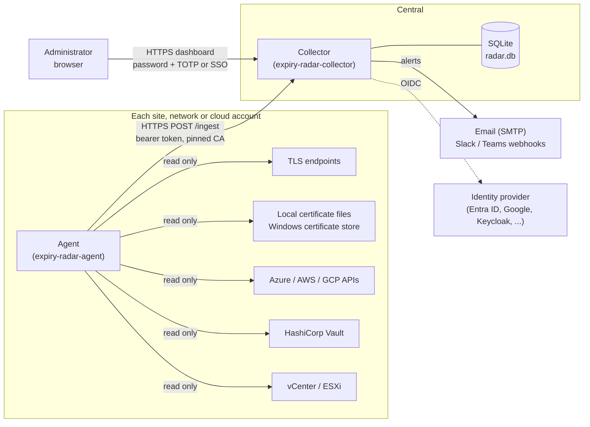
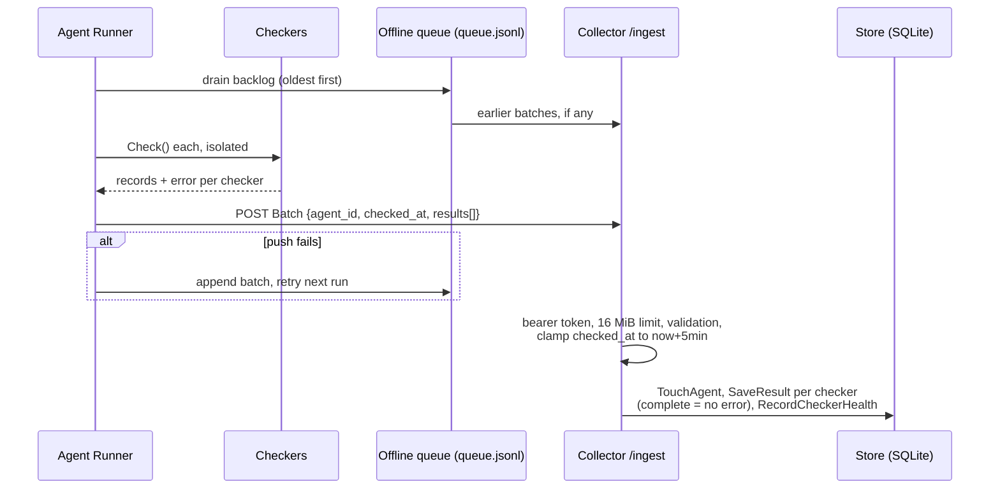
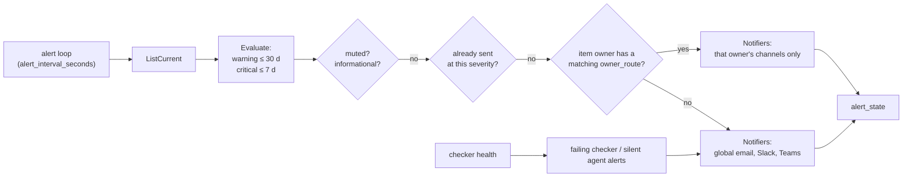
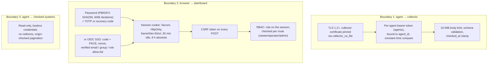
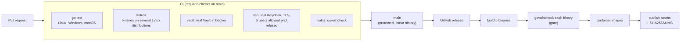

# Expiry Radar architecture

> 🇵🇹 Versão em português: [ARQUITETURA.md](ARQUITETURA.md)

This document explains how Expiry Radar is built: its parts, how data flows between them, where the trust boundaries are and which design choices were made, and why. It is meant for contributors and for security reviewers. For installation and configuration, see the [README](../README.md). The per-feature design notes are in [docs/superpowers/specs](superpowers/specs).

## 1. Purpose and principles

Expiry Radar answers one question: **what expires, where and when?** It covers TLS certificates, secrets, keys, credentials and licences across on-premises systems and Azure, AWS, Google Cloud, HashiCorp Vault and VMware. It alerts before the outage, not after.

Principles that shape every part of the code:

| Principle | What it means in practice |
|---|---|
| **Read only** | Checkers list metadata (names, dates, IDs). They never read secret values or private keys, and never change anything in the systems they check. |
| **Pull is local, push is outbound** | Agents run next to what they check and push to the collector over HTTPS. The collector never connects to agents, so agents need no inbound ports. |
| **Missing an alert is worse than a stale one** | When in doubt, a record stays current. An item disappears only after two complete, error-free runs that no longer report it. |
| **Small supply chain** | Go standard library plus `golang.org/x/sys`, `golang.org/x/oauth2` (pure Go, for OIDC) and a pure-Go SQLite driver. No cloud SDKs: each cloud's REST API is called directly. Every release binary is scanned with `govulncheck` before it is published. |
| **Least privilege by default** | Services run as `LocalService` (Windows) or a dedicated `expiry-radar` user (Linux). Cloud checkers use keyless authentication (managed identity, workload identity, instance roles) and need only reader roles. |

## 2. System context



There are two binaries:

- **Agent** (`cmd/agent`). Runs the configured checkers on a schedule and pushes the results. It has no listening ports and no persistent state, apart from a small offline queue.
- **Collector** (`cmd/collector`). Receives results, stores them, decides what is current, sends alerts and serves the dashboard. It owns all persistent state.

The two binaries can run on the same machine. A typical small installation is a single collector plus an agent on the same host. Larger ones add an agent per network segment, VNet, VPC or site that cannot be reached from elsewhere.

## 3. Code layout

```
cmd/
  agent/            agent main: config, checker wiring, run loop
  collector/        collector main: config, admin CLI (password, TOTP, gen-cert), service entry
internal/
  checker/          Checker interface, ExpiryRecord, Result and Batch (the wire format)
    tls/            TLS endpoints (handshake, leaf certificate)
    local/          certificate files; Windows LocalMachine certificate stores
    vault/          Vault PKI, KV v2 metadata, AppRole secret IDs, tokens, leases
    azure/          Key Vault, App Registrations (Graph), App Service, Front Door, App Gateway
    aws/            ACM, IAM server certificates, IAM access keys, Secrets Manager
    gcp/            Certificate Manager, Compute SSL, service account keys, Secret Manager
    vmware/         vCenter/ESXi certificates, vSphere licences
  agent/            Runner (runs checkers), Pusher (HTTPS client), Queue (offline JSONL)
  auth/             bearer-token middleware for /ingest
  collector/
    server/         wiring: config validation, routes, TLS server, background loops
    certwatch/      reloads the collector's own TLS cert/key from disk on renewal, no restart, no exec
    internalca/     a small internal CA (pure crypto/x509, no exec) for installs with no public domain
    ingest/         POST /ingest: validate and store a batch
    store/          SQLite persistence; "what is current" logic
    db/             schema migrations
    alert/          severity evaluation, deduplication, notifier interface
      notifiers/    email (SMTP), Slack, Teams
    rules/          per-item mute and owner
    dashboard/      HTML pages, embedded CSS/JS, CSV/JSON export
    session/        dashboard sessions, CSRF tokens, role (admin/operator/viewer)
    admin/          administrator account: password hash, TOTP, recovery codes, lockout
    audit/          audit log: who did what, when, old/new value and reason
    sso/            OpenID Connect login (authorization code + PKCE); role mapping from groups/roles to admin/operator/viewer
    export/         CSV and JSON export
  service/          Windows service integration (SCM, Event Log); console fallback
  logging/          log sanitising (strips control characters and secrets)
scripts/            build, vulnerability gate, CI helpers
test/keycloak/      realm used by the SSO end-to-end test
install-expiry-radar.ps1 / .sh   interactive installers (Windows / Linux)
```

## 4. The checker model

Every source of expiry dates implements one interface (`internal/checker/checker.go`):

```go
type Checker interface {
    Name() string                                     // e.g. "tls-checker", "aws-secrets"
    Kind() string                                     // main record kind
    Check(ctx context.Context) ([]ExpiryRecord, error)
}

type ExpiryRecord struct {
    Source    string            // where it lives: tls://host:443, azure://kv.vault.azure.net, file:///etc/ssl/x.pem
    Name      string            // what it is: CN, secret name, key ID
    Kind      string            // certificate, secret, key, access_key, license, ...
    ExpiresAt time.Time
    Metadata  map[string]string // issuer, thumbprint, region, owner hints; never secret values
}
```

An item's identity is **(source, name, kind)**. The same identity reported by two agents is the same item: the dashboard shows the newest report.

`Check` may return records **and** an error at the same time. A checker that covers many targets reports what it could reach and joins the errors for the rest. The agent sends both. The collector stores the records and marks the run **incomplete**, which matters for the "gone" logic in section 6.

To keep a failure in one service from making others incomplete, a cloud provider is split into several checkers. For example, AWS is split into `aws` (certificates), `aws-access-keys` and `aws-secrets`.

### Common rules for cloud checkers

- **REST only, no SDKs.** AWS requests are signed with SigV4, implemented in-house and checked against the AWS test suite. Azure and GCP use OAuth2 bearer tokens.
- **Keyless authentication.** Azure uses managed identity, workload identity or a certificate. AWS uses an instance role, web identity or IAM Roles Anywhere. GCP uses the metadata server or workload identity federation. Long-lived secrets are never stored in the agent config.
- **No redirects followed.** Pagination links must stay on the same origin. Retries apply only to 429, 5xx and throttling.
- **Dates.** An empty date is skipped, because not everything expires. An unreadable date is an error, because silently dropping it could hide an expiry.
- **Informational records.** Records with `metadata.alerts=off` are shown but never alerted. This applies only to access keys and service account keys, for example a disabled key.

## 5. Data flow: one agent run



- **`checked_at` is the agent's run time**, not the time the batch arrived. A batch that waited in the queue keeps its original time, so it cannot overwrite newer data. The collector rejects anything more than 5 minutes in the future, so a bad agent clock cannot pin an item as "current" forever.
- **The queue** is a JSONL file. Batches are drained in order before each new run, so an outage of the collector loses nothing.

## 6. Collector internals

### Storage

SQLite, using the pure-Go driver (no CGO), in one file (`db_path`). Main tables:

| Table | Holds |
|---|---|
| `expiry_records` | every report: source, name, kind, expires_at, metadata, reported_by, checked_at, checker_name |
| `checker_runs` | per agent and checker: last and previous complete run times |
| `agent_checker_health` | per agent and checker: last seen, last success, consecutive failures, last error |
| `agents` | last time each agent pushed |
| `alert_state` | what was alerted, at which severity, to deduplicate |
| `rules` | per item: muted, owner, mute reason, mute expiry |
| `admin_account`, `admin_recovery_codes`, `admin_sessions`, `sso_flows` | dashboard authentication; `admin_sessions` also carries the session's actor and role (admin/operator/viewer) |
| `audit_log` | who did what, when: logins, mutes/unmutes/re-owns and destructive admin actions (forget an agent, sign out all sessions), with old/new value and reason |

Schema changes are forward migrations in `internal/collector/db`, applied at start-up.

### What is "current"

`store.ListCurrent` takes, for each (source, name, kind), the newest report per agent and then, across agents, the one **expiring first** (an endpoint behind a load balancer may still serve an old certificate, and no agent can mask what another one sees; reports more than 48 h behind the item's newest one do not count). An item is **gone**, and stops being shown and alerted, only after the checker that reported it has completed **two** error-free runs on that agent without it. One run is not enough, because a load balancer may alternate certificates between requests. Other rules:

- A failing run never hides anything, since it may be partial.
- Rows from before checker names were stored are gone only once every checker on that agent has completed.
- A forgotten agent's rows disappear until it reports again.

When an item is resolved as gone, the collector sends a "no longer reported" notification, unless the item is muted.

### Alerts



- An alert is sent once per item per severity. Escalating from warning to critical sends again, and a renewal resets the state.
- Failing checkers and agents that stop reporting raise their own alerts, because a silent agent means no expiry alerts for everything it watched.
- Notifier messages are sanitised: no header injection in email, no markup injection in chat.
- **Owner routing.** An item's `owner` (set from the dashboard's mute/re-own form) is carried on its `alert.Notification`. If `owner_routes` has a matching entry, delivery goes **only** to that owner's own channels (never also to the global ones, to avoid duplicate noise). An owner with no matching route still falls back to the global channels, so nothing is silently dropped.

### Dashboard

Server-rendered `html/template` pages, with the CSS and a small vanilla JavaScript file embedded in the binary and served from `/static/`. There is no framework and no CDN, so the dashboard works on isolated networks and without JavaScript. Features: summary cards, filters, sorting, per-item mute (with a mandatory reason and optional expiry) and owner, history, agent and checker health, CSV/JSON export, and dark, light or auto themes. Every mute, unmute, re-own and destructive admin action is written to `audit_log` with the actor, old/new value and reason.

### Roles (RBAC)

Three roles — `admin`, `operator`, `viewer` — rank `admin > operator > viewer`; an empty or unknown role satisfies nothing (fails closed). `session.RoleAtLeast(role, min)` is the single gating primitive, checked both in dashboard handlers and before destructive admin actions:

| Role | May do |
|---|---|
| `viewer` | Read-only: dashboard, history, export. |
| `operator` | Everything a viewer can, plus mute/unmute and re-own (`POST /rules`). |
| `admin` | Everything an operator can, plus forgetting an agent and signing out every session — both are destructive (they end or erase more than the caller's own access) and admin-only, and both are audit-logged. |

Who may log in (`allowed_groups`/`allowed_roles`/`allowed_emails`) and what an already-authorized person may do (`admin_groups`/`operator_groups`/`admin_roles`/`operator_roles`, mapped by `sso.RoleFor`) are independent checks: the login gate always runs first, so being in an admin group never bypasses it. A provider with none of the role keys set keeps the pre-RBAC behavior (every authorized user is admin); setting them on one provider never affects another. The local Administrator account and `admin_tokens` bearer requests are always admin. Upgrading never drops a session or any configuration: a session created before the `role` column existed reads back `''` (added via an additive `ALTER TABLE`, never a destructive migration) and fails closed on gated routes until that browser logs in again, within its normal lifetime (at most 8h) — a safety re-login, not data loss.

## 7. Security model

### Trust boundaries



| Threat | Mitigation |
|---|---|
| Stolen agent token | Can only submit reports, never read data, and only as its own agent: per-agent tokens (`agents`) are bound to an `agent_id`, so a batch claiming another agent is refused (403). Remove the entry to revoke it. Shared `auth_tokens` (older setups) lack this binding and log a warning. |
| Fake collector | Agents trust only `collector_ca_file`, not the system roots, when it is set. |
| Fake report hiding an expiry | When agents disagree, the earliest expiry wins and a row with `alerts=off` never beats one that alerts, so no agent can mask what another sees; rows more than 48 h older than the newest report for the item are ignored; items vanish only after two complete runs of the agent that reported them; future timestamps are clamped. A compromised agent can still lie about the items only it reports. |
| Password guessing | Per-address throttle (5 per 15 min) and account lockout after 20 failures; TOTP required. |
| Session theft or CSRF | Strict cookie flags, short lifetimes, CSRF tokens, "sign out all sessions" button. |
| XSS or clickjacking | Contextual escaping by `html/template`; CSP `default-src 'self'` with no inline scripts or styles; `frame-ancestors 'none'`; HSTS. |
| SSO misuse | Only allow-listed verified emails, groups or app roles; issuer must be HTTPS; flows are bound to the browser. |
| Over-privileged session | RBAC: destructive actions (forget an agent, sign out every session) are admin-only; mutating actions (mute/re-own) need operator or higher; an unknown or pre-RBAC role satisfies nothing, so it fails closed rather than defaulting to admin. |
| Alert routed to the wrong channel | `owner_routes` only ever adds a destination for a matching `owner`; an item with no owner, or an owner with no route, always still reaches the global channels — a misconfigured route narrows delivery, it never silences an alert. |
| Secrets in logs | `logging.Sanitize` redacts PEM blocks and `password=`/`token=`-style pairs and escapes control characters; config secrets are read from files (`*_file`), never from the command line. |
| Oversized pushes | `/ingest` reads at most 16 MiB per batch (413 beyond that). |
| Vulnerable dependencies | `govulncheck` in CI, a release gate on every binary, and a weekly audit that opens an issue. |

### Secrets at rest

| Secret | Where | Protection |
|---|---|---|
| Collector TLS key | `collector.key` | Mode 0600, or an ACL limited to Administrators and the service account |
| Agent and admin tokens | `collector.json`, `agent.json` | Same restrictive permissions; the installers set them |
| Admin password | database | PBKDF2 hash only |
| TOTP secret, recovery codes | database | Recovery codes stored hashed |
| SSO client secret, SMTP password, VMware password | separate files referenced by `*_file` | Read at start-up |

## 8. Deployment and operations

- **Platforms.** Linux amd64 and arm64, Windows amd64, and container images for both binaries (`ghcr.io/joao-paulino/expiry-radar-{agent,collector}`).
- **Services.** On Windows, `install-service` registers a native service with automatic start, restart on failure, Event Log output and `LocalService` by default. On Linux, a hardened systemd unit runs as a dedicated user (`NoNewPrivileges`, `ProtectSystem=strict`). Both installers verify downloads against `SHA256SUMS`.
- **Certificates.** `collector gen-cert` creates a self-signed ECDSA P-256 certificate without OpenSSL. A CA-issued certificate (Let's Encrypt, an internal PKI) can be used instead. For installs with no public domain and no company PKI, `gen-cert --ca <dir>` uses `internal/collector/internalca` instead: a small root CA (ECDSA P-256, 10-year validity, created once in `<dir>` and reused on later runs) that issues the collector's leaf certificate. Agents then trust that CA's `ca.crt`, not the leaf `collector.crt` — the same leaf-vs-root distinction as any PKI — which means re-issuing a new leaf later (a new hostname, a second collector) needs no new trust file pushed to agents. `IssueCertificate` is pure `crypto/x509`: no exec, no network call, same zero-new-attack-surface property as hot-reload below. Either way, `internal/collector/certwatch` watches `tls_cert_file`/`tls_key_file`'s modification time (checked every minute) and reloads the certificate in memory on change, so a renewal — a cron job or certbot's own timer running outside the collector — never needs a restart. The collector only ever reads those two files: it never executes a script, calls a DNS provider or holds a DNS credential, so M14's TLS automation adds no new attack surface to the process. A bad new pair (for example a renewal that wrote a fresh cert before its key) is rejected and the previous, still-valid certificate keeps being served.
- **Backups.** Back up `radar.db` (with the collector stopped, or with `sqlite3 .backup`) and the config files. Reinstalling with the installers moves the old folder aside instead of deleting it.

## 9. Build, test and release



- `main` is protected: PRs only, linear history and required checks, with no bypass.
- Builds are reproducible: `-trimpath`, version stamped through `-ldflags`, and `CGO_ENABLED=0`.
- A release publishes nothing unless every binary passes the vulnerability gate.

## 10. Extending: adding a checker

1. Create `internal/checker/<name>` with a `Config` (JSON tags, a `Validate` method that does no I/O) and one or more types that implement `checker.Checker`.
2. Return `ExpiryRecord`s with a stable `Source`, `Name` and `Kind`. Put only non-secret metadata in `Metadata`.
3. Return partial records plus a joined error when some targets fail. Split independent services into separate checkers.
4. Wire it in `cmd/agent/main.go` (config field, validation, `checkers()`), and add a test there that it is included.
5. Test against a fake server built with `httptest`. If the service can run in Docker, add a CI job against the real thing.
6. Document the config section and the least-privilege permissions in the README.

## 11. Known limits

- A single collector with SQLite. This suits thousands of items and tens of agents; there is no built-in high availability. A failed collector loses no data that agents still hold in their queues.
- A compromised agent can misreport the items only it reports (with per-agent tokens it cannot touch other agents' items).
- A batch larger than 16 MiB is refused and stays in the agent's queue; split very large estates across several agents.
- Thresholds (30 and 7 days) are global per kind and cannot be set per item.
- Not yet covered: GCP regional secrets, industrial (ICS/OT) devices, and Kubernetes secrets and cert-manager.
