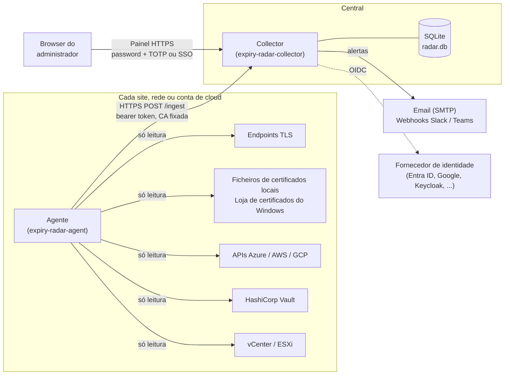
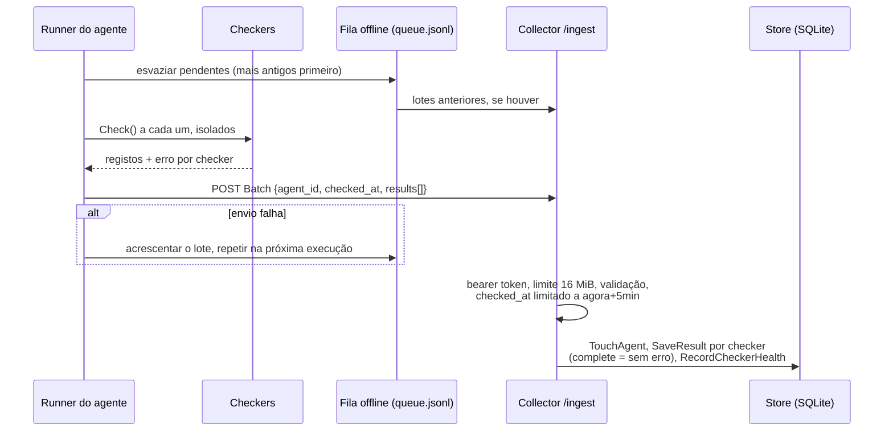
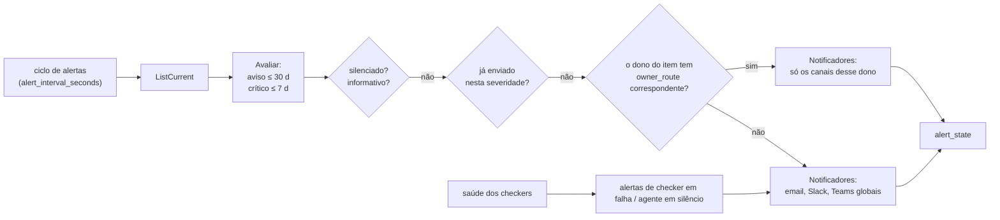
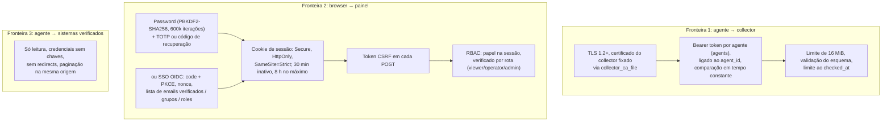

# Arquitetura do Expiry Radar

> 🇬🇧 English version: [ARCHITECTURE.md](ARCHITECTURE.md)

Este documento explica como o Expiry Radar está construído: as peças que o compõem, como os dados circulam entre elas, onde ficam as fronteiras de confiança e que decisões de desenho foram tomadas, e porquê. Destina-se a quem contribui para o projeto e a quem faz revisões de segurança. Para instalar e configurar, vê o [README](../README.md). As notas de desenho de cada funcionalidade estão em [docs/superpowers/specs](superpowers/specs).

## 1. Objetivo e princípios

O Expiry Radar responde a uma pergunta: **o que expira, onde e quando?** Cobre certificados TLS, segredos, chaves, credenciais e licenças em sistemas locais e no Azure, AWS, Google Cloud, HashiCorp Vault e VMware. Avisa antes da falha, não depois.

Princípios que moldam todo o código:

| Princípio | Na prática |
|---|---|
| **Só leitura** | Os checkers listam metadados (nomes, datas, identificadores). Nunca leem valores de segredos nem chaves privadas, e nunca alteram nada nos sistemas que verificam. |
| **Recolha local, envio para fora** | Os agentes correm junto do que verificam e enviam para o collector por HTTPS. O collector nunca liga aos agentes, por isso os agentes não precisam de portas de entrada abertas. |
| **Falhar um alerta é pior do que um alerta desatualizado** | Na dúvida, um registo continua atual. Um item só desaparece depois de duas execuções completas, sem erros, que já não o reportam. |
| **Cadeia de fornecimento pequena** | Biblioteca padrão do Go, mais `golang.org/x/sys`, `golang.org/x/oauth2` (Go puro, para OIDC) e um driver SQLite em Go puro. Sem SDKs de cloud: a API REST de cada cloud é chamada diretamente. Cada binário de um release é analisado com `govulncheck` antes de ser publicado. |
| **Privilégio mínimo por omissão** | Os serviços correm como `LocalService` (Windows) ou com um utilizador próprio `expiry-radar` (Linux). Os checkers de cloud usam autenticação sem chaves (managed identity, workload identity, roles de instância) e precisam apenas de roles de leitura. |

## 2. Contexto do sistema



Há dois binários:

- **Agente** (`cmd/agent`). Corre os checkers configurados de forma periódica e envia os resultados. Não tem portas à escuta nem estado persistente, exceto uma pequena fila offline.
- **Collector** (`cmd/collector`). Recebe os resultados, guarda-os, decide o que está atual, envia alertas e serve o painel. Todo o estado persistente fica do seu lado.

Os dois binários podem correr na mesma máquina. Uma instalação pequena típica é um collector e um agente no mesmo servidor. As maiores acrescentam um agente por segmento de rede, VNet, VPC ou site que não seja alcançável de outro lado.

## 3. Organização do código

```
cmd/
  agent/            main do agente: config, ligação dos checkers, ciclo de execução
  collector/        main do collector: config, CLI de admin (password, TOTP, gen-cert), arranque como serviço
internal/
  checker/          interface Checker, ExpiryRecord, Result e Batch (o formato na rede)
    tls/            endpoints TLS (handshake, certificado final)
    local/          ficheiros de certificados; lojas LocalMachine do Windows
    vault/          Vault PKI, metadados KV v2, secret IDs AppRole, tokens, leases
    azure/          Key Vault, App Registrations (Graph), App Service, Front Door, App Gateway
    aws/            ACM, certificados IAM, chaves de acesso IAM, Secrets Manager
    gcp/            Certificate Manager, SSL do Compute, chaves de service accounts, Secret Manager
    vmware/         certificados vCenter/ESXi, licenças vSphere
  agent/            Runner (corre os checkers), Pusher (cliente HTTPS), Queue (fila JSONL offline)
  auth/             middleware de bearer token para /ingest
  collector/
    server/         ligação geral: validação da config, rotas, servidor TLS, ciclos em segundo plano
    certwatch/      recarrega o certificado TLS do próprio collector do disco quando é renovado, sem reiniciar, sem exec
    internalca/     uma CA interna pequena (crypto/x509 puro, sem exec) para instalações sem domínio público
    ingest/         POST /ingest: validar e guardar um lote
    store/          persistência SQLite; lógica do "o que está atual"
    db/             migrações do esquema
    alert/          avaliação de severidade, deduplicação, interface de notificadores
      notifiers/    email (SMTP), Slack, Teams
    rules/          silenciar e dono por item
    dashboard/      páginas HTML, CSS/JS embebidos, exportação CSV/JSON
    session/        sessões do painel, tokens CSRF, papel (admin/operator/viewer)
    admin/          conta de administrador: hash da password, TOTP, códigos de recuperação, bloqueio
    audit/          registo de auditoria: quem fez o quê, quando, valor antigo/novo e motivo
    sso/            login OpenID Connect (authorization code + PKCE); mapeamento de grupos/roles para admin/operator/viewer
    export/         exportação CSV e JSON
  service/          integração com serviços Windows (SCM, Event Log); modo consola
  logging/          limpeza de logs (remove caracteres de controlo e segredos)
scripts/            build, gate de vulnerabilidades, auxiliares de CI
test/keycloak/      realm usado no teste de ponta a ponta do SSO
install-expiry-radar.ps1 / .sh   instaladores interativos (Windows / Linux)
```

## 4. O modelo de checkers

Cada fonte de datas de expiração implementa uma única interface (`internal/checker/checker.go`):

```go
type Checker interface {
    Name() string                                     // ex.: "tls-checker", "aws-secrets"
    Kind() string                                     // tipo principal de registo
    Check(ctx context.Context) ([]ExpiryRecord, error)
}

type ExpiryRecord struct {
    Source    string            // onde está: tls://host:443, azure://kv.vault.azure.net, file:///etc/ssl/x.pem
    Name      string            // o que é: CN, nome do segredo, ID da chave
    Kind      string            // certificate, secret, key, access_key, license, ...
    ExpiresAt time.Time
    Metadata  map[string]string // emissor, thumbprint, região, pistas de dono; nunca valores secretos
}
```

A identidade de um item é **(source, name, kind)**. A mesma identidade reportada por dois agentes é o mesmo item, e o painel mostra o relatório mais recente.

O `Check` pode devolver registos **e** um erro ao mesmo tempo. Um checker que cobre muitos alvos reporta o que conseguiu alcançar e junta os erros dos restantes. O agente envia as duas coisas. O collector guarda os registos e marca a execução como **incompleta**, o que conta para a lógica do "desaparecido" da secção 6.

Para que uma falha num serviço não torne os outros incompletos, cada fornecedor de cloud está dividido em vários checkers. Por exemplo, a AWS está dividida em `aws` (certificados), `aws-access-keys` e `aws-secrets`.

### Regras comuns aos checkers de cloud

- **Só REST, sem SDKs.** Os pedidos à AWS são assinados com SigV4, implementado no projeto e validado contra a suite de testes da AWS. Azure e GCP usam bearer tokens OAuth2.
- **Autenticação sem chaves.** No Azure: managed identity, workload identity ou certificado. Na AWS: role de instância, web identity ou IAM Roles Anywhere. No GCP: servidor de metadados ou workload identity federation. Nunca ficam segredos de longa duração guardados na config do agente.
- **Nunca seguir redirects.** Os links de paginação têm de ficar na mesma origem. Só se repete o pedido perante 429, 5xx ou throttling.
- **Datas.** Uma data vazia é ignorada, porque nem tudo expira. Uma data ilegível é um erro, porque descartá-la em silêncio podia esconder uma expiração.
- **Registos informativos.** Os registos com `metadata.alerts=off` aparecem no painel mas nunca geram alertas. Só se aplica a chaves de acesso e chaves de service accounts, por exemplo uma chave desativada.

## 5. Fluxo de dados: uma execução do agente



- **O `checked_at` é a hora da execução no agente**, não a hora de chegada do lote. Um lote que esteve na fila mantém a hora original, por isso não sobrepõe dados mais recentes. O collector recusa horas mais de 5 minutos no futuro, para que um relógio errado num agente não fixe um item como "atual" para sempre.
- **A fila** é um ficheiro JSONL. Os lotes são enviados por ordem antes de cada nova execução, por isso uma indisponibilidade do collector não faz perder nada.

## 6. Interior do collector

### Armazenamento

SQLite, com o driver em Go puro (sem CGO), num único ficheiro (`db_path`). Tabelas principais:

| Tabela | Guarda |
|---|---|
| `expiry_records` | cada relatório: source, name, kind, expires_at, metadata, reported_by, checked_at, checker_name |
| `checker_runs` | por agente e checker: hora da última e da penúltima execução completa |
| `agent_checker_health` | por agente e checker: última vez visto, último sucesso, falhas consecutivas, último erro |
| `agents` | última vez que cada agente enviou dados |
| `alert_state` | o que já foi alertado e com que severidade, para não repetir |
| `rules` | por item: silenciado, dono, motivo do silêncio, data de fim do silêncio |
| `admin_account`, `admin_recovery_codes`, `admin_sessions`, `sso_flows` | autenticação do painel; `admin_sessions` também guarda o actor e o papel da sessão (admin/operator/viewer) |
| `audit_log` | quem fez o quê, quando: logins, silenciar/retirar silêncio/mudar dono e ações destrutivas de admin (esquecer um agente, terminar todas as sessões), com valor antigo/novo e motivo |

As alterações ao esquema são migrações progressivas em `internal/collector/db`, aplicadas no arranque.

### O que está "atual"

O `store.ListCurrent` pega, para cada (source, name, kind), no relatório mais recente de cada agente e depois, entre agentes, no que **expira primeiro** (um endpoint atrás de um load balancer pode ainda servir um certificado antigo, e nenhum agente consegue esconder o que outro vê; relatórios com mais de 48 h de atraso face ao mais recente do item não contam). Um item é considerado **desaparecido**, e deixa de ser mostrado e alertado, só depois de o checker que o reportava ter feito **duas** execuções completas sem erros nesse agente sem o voltar a reportar. Uma só não chega, porque um load balancer pode alternar certificados entre pedidos. Outras regras:

- Uma execução com erros nunca esconde nada, porque pode estar incompleta.
- Os registos anteriores ao armazenamento do nome do checker só desaparecem quando todos os checkers desse agente tiverem completado.
- Os registos de um agente esquecido desaparecem até ele voltar a reportar.

Quando um item fica desaparecido, o collector envia uma notificação de "deixou de ser reportado", exceto se o item estiver silenciado.

### Alertas



- Cada item gera um alerta por severidade. Passar de aviso a crítico volta a enviar, e uma renovação repõe o estado.
- Checkers em falha e agentes que deixam de reportar geram alertas próprios, porque um agente calado significa nenhum alerta de expiração para tudo o que ele vigiava.
- As mensagens dos notificadores são limpas: sem injeção de cabeçalhos no email nem de formatação no chat.
- **Encaminhamento por dono.** O `owner` de um item (definido no formulário de silenciar/mudar dono do painel) viaja no seu `alert.Notification`. Se `owner_routes` tiver uma entrada correspondente, a entrega vai **só** para os canais desse dono (nunca também para os globais, para evitar duplicação de ruído). Um dono sem rota correspondente continua a cair nos canais globais — nada se perde silenciosamente.

### Painel

Páginas geradas no servidor com `html/template`, com o CSS e um pequeno ficheiro de JavaScript simples embebidos no binário e servidos em `/static/`. Não há framework nem CDN, por isso o painel funciona em redes isoladas e sem JavaScript. Funcionalidades: cartões de resumo, filtros, ordenação, silenciar (com motivo obrigatório e data de fim opcional) e dono por item, histórico, saúde dos agentes e checkers, exportação CSV/JSON e temas escuro, claro ou automático. Cada silenciar, retirar silêncio, mudar dono e ação destrutiva de admin fica registado em `audit_log`, com o actor, o valor antigo/novo e o motivo.

### Papéis (RBAC)

Três papéis — `admin`, `operator`, `viewer` — ordenados `admin > operator > viewer`; um papel vazio ou desconhecido não satisfaz nenhum (falha fechado). O `session.RoleAtLeast(role, min)` é o único mecanismo de controlo, verificado tanto nos handlers do painel como antes de ações destrutivas de admin:

| Papel | Pode fazer |
|---|---|
| `viewer` | Só leitura: painel, histórico, exportação. |
| `operator` | Tudo o que um viewer pode, mais silenciar/retirar silêncio e mudar dono (`POST /rules`). |
| `admin` | Tudo o que um operator pode, mais esquecer um agente e terminar todas as sessões — ambas destrutivas (acabam com ou apagam mais do que o acesso do próprio chamador) e só para admin, e ambas registadas em auditoria. |

Quem pode entrar (`allowed_groups`/`allowed_roles`/`allowed_emails`) e o que uma pessoa já autorizada pode fazer (`admin_groups`/`operator_groups`/`admin_roles`/`operator_roles`, mapeados pelo `sso.RoleFor`) são verificações independentes: o portão de login corre sempre primeiro, por isso estar num grupo admin nunca o ultrapassa. Um fornecedor sem nenhuma destas chaves mantém o comportamento anterior ao RBAC (todos os utilizadores autorizados são admin); defini-las num fornecedor nunca afeta outro. A conta Administrator local e os pedidos com `admin_tokens` são sempre admin. Fazer upgrade nunca descarta uma sessão nem configuração: uma sessão criada antes de existir a coluna `role` lê `''` (acrescentada por um `ALTER TABLE` aditivo, nunca uma migração destrutiva) e falha fechado nas rotas protegidas até esse browser fazer novo login, dentro da sua duração normal (no máximo 8h) — é um novo login de segurança, não perda de dados.

## 7. Modelo de segurança

### Fronteiras de confiança



| Ameaça | Mitigação |
|---|---|
| Token de agente roubado | Só serve para enviar relatórios, nunca para ler dados, e apenas como o seu próprio agente: os tokens por agente (`agents`) estão ligados a um `agent_id`, e um envio com outro agente é recusado (403). Para revogar, retira a entrada. Os `auth_tokens` partilhados (instalações antigas) não têm esta ligação e geram um aviso. |
| Collector falso | Quando `collector_ca_file` está definido, os agentes só confiam nesse certificado, não nas raízes do sistema. |
| Relatório falso a esconder uma expiração | Quando os agentes discordam, ganha a expiração mais próxima e uma linha com `alerts=off` nunca ganha a uma que alerta, por isso nenhum agente esconde o que outro vê; linhas mais de 48 h mais antigas do que o relatório mais recente do item são ignoradas; os itens só desaparecem após duas execuções completas do agente que os reportou; as datas no futuro são limitadas. Um agente comprometido ainda pode mentir sobre os itens que só ele reporta. |
| Adivinhar a password | Limite por endereço (5 em 15 min) e bloqueio da conta após 20 falhas; TOTP obrigatório. |
| Roubo de sessão ou CSRF | Cookies com flags restritas, durações curtas, tokens CSRF e botão "terminar todas as sessões". |
| XSS ou clickjacking | Escape contextual pelo `html/template`; CSP `default-src 'self'` sem scripts nem estilos inline; `frame-ancestors 'none'`; HSTS. |
| Abuso do SSO | Só entram emails verificados, grupos ou roles da aplicação que estejam na lista; o emissor tem de ser HTTPS; o fluxo fica ligado ao browser que o iniciou. |
| Sessão com privilégios excessivos | RBAC: ações destrutivas (esquecer um agente, terminar todas as sessões) só para admin; ações que alteram estado (silenciar/mudar dono) precisam de operator ou superior; um papel desconhecido ou anterior ao RBAC não satisfaz nada, por isso falha fechado em vez de assumir admin por omissão. |
| Alerta encaminhado para o canal errado | O `owner_routes` só acrescenta um destino para um `owner` correspondente; um item sem dono, ou um dono sem rota, continua sempre a chegar aos canais globais — uma rota mal configurada restringe a entrega, nunca silencia um alerta. |
| Segredos nos logs | O `logging.Sanitize` oculta blocos PEM e pares do tipo `password=`/`token=` e escapa caracteres de controlo; os segredos da config são lidos de ficheiros (`*_file`), nunca da linha de comandos. |
| Envios demasiado grandes | O `/ingest` lê no máximo 16 MiB por lote (413 acima disso). |
| Dependências vulneráveis | `govulncheck` no CI, gate no release sobre cada binário e auditoria semanal que abre uma issue. |

### Segredos em repouso

| Segredo | Onde | Proteção |
|---|---|---|
| Chave TLS do collector | `collector.key` | Modo 0600, ou ACL só para Administradores e para a conta do serviço |
| Tokens de agente e de admin | `collector.json`, `agent.json` | As mesmas permissões restritas; os instaladores aplicam-nas |
| Password de admin | base de dados | Só o hash PBKDF2 |
| Segredo TOTP, códigos de recuperação | base de dados | Os códigos de recuperação ficam guardados em hash |
| Segredo do cliente SSO, password SMTP, password VMware | ficheiros separados indicados por `*_file` | Lidos no arranque |

## 8. Instalação e operação

- **Plataformas.** Linux amd64 e arm64, Windows amd64 e imagens de contentor para os dois binários (`ghcr.io/joao-paulino/expiry-radar-{agent,collector}`).
- **Serviços.** No Windows, o `install-service` regista um serviço nativo com arranque automático, reinício em caso de falha, saída para o Event Log e `LocalService` por omissão. No Linux, uma unit systemd endurecida corre com um utilizador próprio (`NoNewPrivileges`, `ProtectSystem=strict`). Os dois instaladores verificam os downloads contra o `SHA256SUMS`.
- **Certificados.** O `collector gen-cert` cria um certificado autoassinado ECDSA P-256 sem OpenSSL. Também se pode usar um certificado emitido por uma CA (Let's Encrypt, uma PKI interna). Para instalações sem domínio público e sem PKI da empresa, o `gen-cert --ca <dir>` usa o `internal/collector/internalca`: uma CA raiz pequena (ECDSA P-256, validade de 10 anos, criada uma vez em `<dir>` e reaproveitada nas execuções seguintes) que emite o certificado-folha do collector. Os agentes passam então a confiar no `ca.crt` dessa CA, não no certificado-folha `collector.crt` — a mesma distinção folha-vs-raiz de qualquer PKI — o que significa que reemitir uma folha nova mais tarde (um nome novo, um segundo collector) não precisa de um novo ficheiro de confiança para os agentes. O `IssueCertificate` é `crypto/x509` puro: sem exec, sem chamada de rede, a mesma propriedade de zero superfície de ataque nova do hot-reload abaixo. De qualquer forma, o `internal/collector/certwatch` vigia a data de modificação de `tls_cert_file`/`tls_key_file` (verificada a cada minuto) e recarrega o certificado em memória quando muda, por isso uma renovação — feita por um cron ou pelo próprio timer do certbot, fora do collector — nunca precisa de um reinício. O collector só lê estes dois ficheiros: nunca executa um script, nunca fala com um fornecedor de DNS nem guarda credenciais de DNS, por isso a automação de TLS do M14 não acrescenta nenhuma superfície de ataque nova ao processo. Um par novo inválido (por exemplo uma renovação que escreveu o certificado novo antes da chave) é rejeitado e continua a servir-se o certificado anterior, ainda válido.
- **Cópias de segurança.** Guarda a `radar.db` (com o collector parado, ou com `sqlite3 .backup`) e os ficheiros de config. Reinstalar com os instaladores põe a pasta antiga de lado em vez de a apagar.

## 9. Build, testes e release

```mermaid
flowchart LR
    PR["Pull request"] --> CI
    subgraph CI["CI (verificações obrigatórias na main)"]
        T1["go test<br/>Linux, Windows, macOS"]
        T2["distros:<br/>binários em várias distribuições Linux"]
        T3["vault: Vault real em Docker"]
        T4["sso: Keycloak real, TLS,<br/>5 utilizadores aceites e recusados"]
        T5["vulns: govulncheck"]
    end
    CI --> M["main<br/>(protegida, histórico linear)"]
    M --> REL["Release no GitHub"]
    REL --> G["build de 6 binários"] --> VG["govulncheck a cada binário<br/>(gate)"] --> IMG["imagens de contentor"] --> PUB["publicar ficheiros<br/>+ SHA256SUMS"]
```



- A `main` está protegida: só por PR, histórico linear e verificações obrigatórias, sem exceções.
- Os builds são reproduzíveis: `-trimpath`, versão definida por `-ldflags` e `CGO_ENABLED=0`.
- Um release não publica nada se algum binário falhar o gate de vulnerabilidades.

## 10. Como acrescentar um checker

1. Cria `internal/checker/<nome>` com um `Config` (tags JSON e um método `Validate` que não faz I/O) e um ou mais tipos que implementem `checker.Checker`.
2. Devolve `ExpiryRecord`s com `Source`, `Name` e `Kind` estáveis. Põe em `Metadata` apenas metadados não secretos.
3. Quando alguns alvos falham, devolve os registos parciais e um erro com todas as falhas. Separa serviços independentes em checkers diferentes.
4. Liga-o em `cmd/agent/main.go` (campo na config, validação, `checkers()`) e acrescenta aí um teste que confirme que é incluído.
5. Testa contra um servidor falso feito com `httptest`. Se o serviço correr em Docker, acrescenta um job de CI contra o serviço real.
6. Documenta no README a secção de config e as permissões mínimas necessárias.

## 11. Limitações conhecidas

- Um único collector com SQLite. Chega para milhares de itens e dezenas de agentes; não há alta disponibilidade incluída. Se o collector falhar, não se perdem os dados que os agentes ainda têm nas suas filas.
- Um agente comprometido pode reportar mal os itens que só ele reporta (com tokens por agente, não consegue mexer nos itens dos outros).
- Um lote maior do que 16 MiB é recusado e fica na fila do agente; num parque muito grande, divide os alvos por vários agentes.
- Os limiares (30 e 7 dias) são globais por tipo e não se podem definir por item.
- Ainda não coberto: segredos regionais do GCP, dispositivos industriais (ICS/OT) e segredos do Kubernetes e cert-manager.
